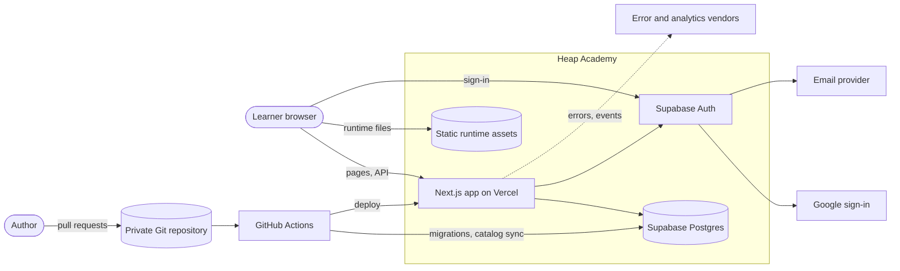
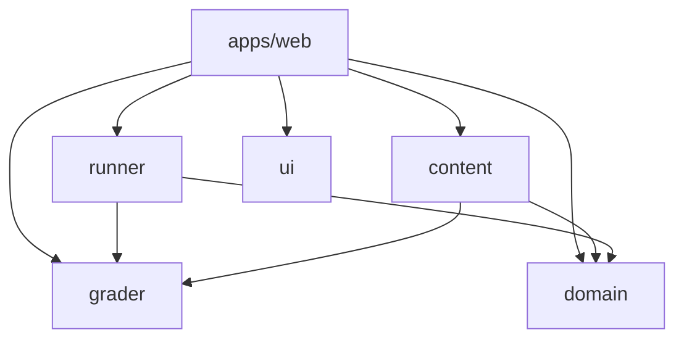
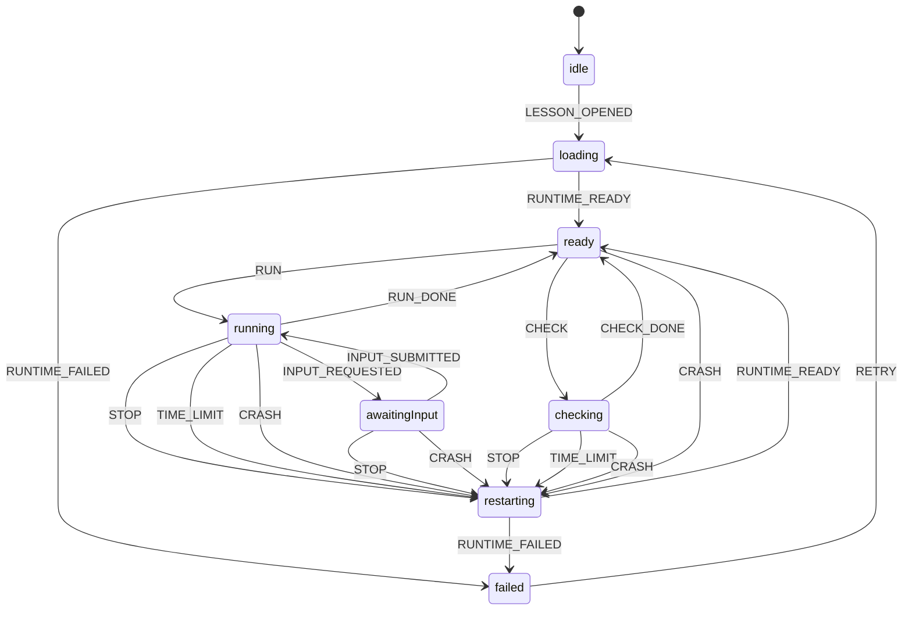
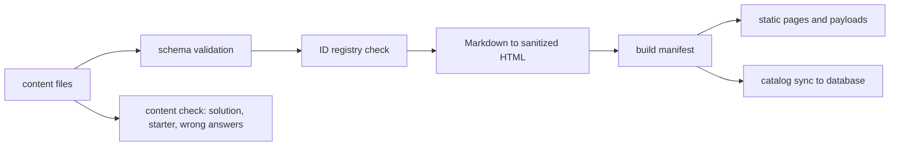
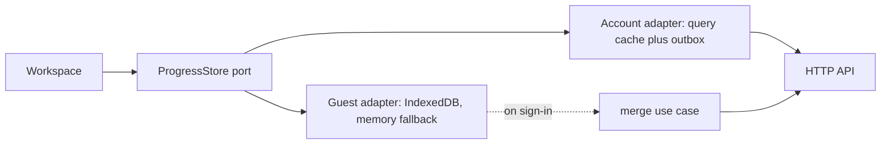

> Archived. Not in force. This file belongs to the original ten-phase plan and is kept for work after the first release. Do not build from it unless the owner says so. The plan in force is in `docs/spec/`.

# 02 Architecture

This document describes the target system for 1.0. Decisions are recorded as ADRs in `docs/adr/`; this file is the map that connects them. Where a statement is backed by a prototype it says (verified) and points to `09-evidence.md`. Phase 2 re-verifies each of those inside the real codebase before anything is built on top.

## 1. Drivers

Ranked. When two concerns conflict, the higher one wins.

1. **Trust in a pass.** A green Check must mean the code is right (G-2).
2. **Safety of running strangers' code.** Learner code must never touch the app's credentials or other learners (NFR-SEC-01).
3. **Time to first Run on a phone.** The first minute decides whether a viewer becomes a learner (G-1).
4. **No lost progress** (G-3).
5. **Near-zero marginal cost** (G-6): no server executes learner code.
6. **Changeability by one person and an agent**: strict boundaries, typed contracts, everything testable in isolation.

## 2. System context



Learner code is executed only inside the learner's browser. Nothing in the platform box ever evaluates it.

## 3. Containers

| Container | Technology | Responsibility |
|---|---|---|
| App server | Next.js App Router on Vercel | Renders pages, serves the versioned HTTP API, verifies identity, applies access policy, reads and writes the database. |
| App client | React, TypeScript | Catalog, course, workspace UI. Orchestrates runtimes. Holds guest progress. |
| Python worker | Pyodide in a module worker | Runs Python and the Python harness. Disposable. |
| Web sandbox | Static document in a sandboxed iframe | Renders learner HTML and CSS and runs the web harness in an opaque origin. Disposable. |
| Runtime assets | Static files, immutable caching | Pyodide distribution and harness files, versioned by path. |
| Database | Supabase Postgres | Catalog reference data, progress, profiles, entitlements, feedback. |
| Identity | Supabase Auth | Google sign-in, email codes, sessions. |
| Pipeline | GitHub Actions | Verification, migrations, catalog sync, deploy, scheduled jobs. |

## 4. Repository structure

One private repository, pnpm workspaces, Turborepo (ADR-0001).

```
apps/web/            Next.js application
packages/domain/     Pure rules. No I/O, no framework imports.
packages/grader/     Test and result schemas, Python harness, web harness, Node runner for CI
packages/runner/     Browser runtime orchestration: protocol, clients, watchdog, statechart
packages/content/    Content schemas, loader, Markdown pipeline, registry, CLI
packages/ui/         Design tokens and primitives, Storybook
packages/config/     Shared TypeScript, lint, and test presets
content/             Courses as files
e2e/                 Playwright suites: journeys, accessibility, visual
supabase/            Migrations, pgTAP tests, seed data, config
docs/                Spec, ADRs, runbooks, reports
brand/               Brand kit supplied by the owner
```

### 4.1 Dependency rules

Enforced by a dependency-rule check in CI (NFR-MAINT-05). A violation fails the build.



- `domain`, `grader`, and `ui` import no other workspace package.
- No package imports from `apps/web`.
- `domain` imports nothing that performs I/O: no `fetch`, no `fs`, no React, no Next, no Supabase, no `Date.now()` without an injected clock.
- Each package exposes a public API through its `exports` map. Deep imports into another package's `src/` are forbidden.
- Bundler entry points that need bundler-specific syntax (worker constructors, asset URLs) live in `apps/web`. Packages export logic, not `new Worker(...)` calls.

### 4.2 Application layers (`apps/web/src`)

```
app/                  Routes. Thin: compose features, no business rules.
features/<name>/      catalog, course, workspace, auth, profile, progress, feedback
  components/         Client and server components for the feature
  server/             Use cases callable from routes and API handlers
  client/             Hooks and stores
  index.ts            The feature's public surface
infrastructure/       db (clients, repositories), auth (verification), telemetry, env, flags
messages/             Message catalogs
workers/              Worker entry files
```

- A feature imports another feature only through its `index.ts`.
- Server-only modules import `server-only`. Client code cannot import `infrastructure/db`.
- Use cases take dependencies as arguments (repositories, clock, id source). They are unit-tested with in-memory fakes.
- The privileged database client is created in one module and is reachable only through repositories that require a `VerifiedUserId`, a branded type that only the auth verification module can construct.

## 5. Python runtime

ADR-0003, ADR-0004, ADR-0005.

### 5.1 Shape

- Pyodide runs in a **module worker**. Pyodide 314 does not support classic workers (verified, E-03).
- The distribution files come from the `pyodide` npm package pinned in the lockfile and are copied at build time to `/_runtime/pyodide/<version>/`. The lockfile hash is the integrity guarantee. Responses are `Cache-Control: public, max-age=31536000, immutable`.
- The base URL is one configuration value (`RUNTIME_ASSET_BASE_URL`) so that the files can later move to a zero-egress asset host without a code change.
- The worker is disposable. Stopping a run means terminating the worker from the page. The worker is never asked to stop itself, because a busy loop cannot read messages.

### 5.2 Protocol (version 1)

Every message is a discriminated union validated with a schema on receipt, on both sides. Unknown or malformed messages are dropped and reported.

| Direction | Message | Purpose |
|---|---|---|
| page to worker | `init { assetBase, harnessVersion }` | Load the runtime and harness. |
| worker to page | `progress { loadedBytes, totalBytes }` | Real download progress, computed against a build-time size manifest. |
| worker to page | `ready { runtimeVersion, capabilities }` | Capabilities include `interactiveInput`. |
| page to worker | `run { runId, files, mode, stdin? }` | `mode` is `interactive` or `batch`. |
| worker to page | `output { runId, stream, text }` | Batched at most every 50 ms. |
| worker to page | `input_request { runId }` | The program is waiting for a line. |
| page to worker | `input { runId, line }` or `input_end { runId }` | Answer, or end of input. |
| worker to page | `run_done { runId, outcome, truncated, durationMs }` | `outcome` is `ok` or a learner error. |
| page to worker | `check { runId, files, tests }` | Run the harness. |
| worker to page | `test_result { runId, result }` | Streamed per test. |
| worker to page | `check_done { runId, summary }` | |
| worker to page | `fatal { reason }` | The worker cannot continue. |

Learner errors have a `kind`: `syntax`, `runtime`, `input_ended`, `output_limit`, `memory`, plus the page-side kinds `time_limit`, `stopped`, `crashed`.

### 5.3 Input strategies

Chosen by capability detection at `ready`, never by user agent (NFR-COMPAT-04).

1. **Interactive** (preferred). `input()` and `sys.stdin` reads call a JavaScript function that returns a promise; Python waits on it with Pyodide's `run_sync`, which uses WebAssembly stack switching. No shared memory and no cross-origin isolation headers are involved (verified in Chromium 153, E-05). Stack switching shipped in Chrome 137, Firefox 153, and Safari 27 (E-08).
2. **Batch** (fallback). The learner types answers into an Input field before Run, one per line. If the program reads past the end, it gets the `input_ended` error with a message that explains the field.

Tests always use batch input from the test definition, so grading does not depend on the strategy.

Cross-origin isolation (and with it `SharedArrayBuffer`) is deliberately not used: it would constrain every embed on the page and is no longer needed for input (ADR-0005).

### 5.4 Watchdog

- The page owns the clock. A run's budget counts only time between `run` (or `input`) and the next `input_request` or `run_done`. Waiting for the learner is free.
- On budget exceeded, Stop, or silence after `fatal`: terminate the worker, report the outcome, start a new worker. Measured cost: terminate is immediate; a new worker is ready in about 1.7 s with warm cache (E-04).
- On devices that report at least 4 GB of memory and no data-saver preference, one spare worker is kept initialized so a restart is instant. Elsewhere a restart loads on demand.

### 5.5 Isolation between runs

Per run, inside one worker (verified, E-04, E-06):

- fresh global namespace with `__name__ == "__main__"`
- `stdin`, `stdout`, `stderr` rebound and restored
- builtins restored from a snapshot, by a routine that itself uses no builtin by name
- modules imported during the run removed from `sys.modules`
- working directory reset; random seed set for tests
- source registered with `linecache` so tracebacks show the learner's line text

A full reset is a new worker. Mutating a preloaded standard library module is not undone by the soft reset; this residual risk is accepted and documented in ADR-0004.

### 5.6 Network lock-down

The worker shares the app's origin, so code a learner was tricked into pasting could otherwise call the app's API with the learner's session. After the runtime has loaded everything it needs, the worker removes network and spawning APIs from its global scope and prototype chain, and its script response carries a policy with `connect-src 'self'` and no `unsafe-eval`. In the prototype, `js.fetch` was then unavailable from Python, evaluating JavaScript from Python was refused, and the standard library still imported (verified for own properties, E-07). This is hardening, not a boundary; see threat T-01 and the residual risks in `06-security-privacy.md`.

### 5.7 Loading

- Nothing about the runtime is requested until a lesson page is open.
- The lesson renders and the editor is usable while the runtime loads (NFR-PERF-03).
- A Run or Check requested while loading is remembered and starts automatically at `ready`.
- Cold download is about 5.5 MB with Brotli (measured, E-02). The course page warms the cache on intent (hover or focus on a lesson link) on unmetered connections only.

## 6. Web runtime

ADR-0006.

### 6.1 Shape

- Learner HTML and CSS render inside an iframe whose document is a static file we serve: `/_sandbox/frame.html` with `/_sandbox/frame.js`.
- The iframe has `sandbox="allow-scripts"` and nothing else. The document's own response carries a content security policy that begins with `sandbox allow-scripts`, so it is an opaque origin even if someone opens the URL directly (verified, E-07).
- The page sends files and tests with `postMessage`; the harness renders, asserts, and replies. The page accepts replies only when `event.source` is that iframe's window.
- Every Run and every Check uses a fresh sandbox document.

### 6.2 Why not `srcdoc`

An `srcdoc` document inherits the embedding page's content security policy. Under the app's strict policy the learner's own `<style>` blocks and `style` attributes are blocked, and every CSS test fails (verified, E-07). A document loaded from a URL has its own policy.

### 6.3 Sandbox policy

Starting policy, verified in Chromium (E-07). WP-2.2 confirms it in Firefox and WebKit.

```
Content-Security-Policy: sandbox allow-scripts; frame-ancestors 'self'; default-src 'none';
  script-src 'self'; style-src 'unsafe-inline'; img-src https: data:; font-src https: data:;
  form-action 'none'; base-uri 'self'
```

- `script-src 'self'` admits only our harness. Learner `<script>` and inline handlers do not run. A future JavaScript course gets its own sandbox profile.
- Do not send `Cross-Origin-Resource-Policy: same-origin` on `/_sandbox/*`: the sandbox is an opaque origin and would be refused its own script. (Not yet verified; first check in WP-2.2.)

### 6.4 Containment

The preview must stay the preview. Controls, each with a test (see `06-security-privacy.md` T-05):

| Vector | Control |
|---|---|
| Link click | Harness cancels navigation for every anchor except same-document fragments and shows an inline note. Backstop: `<base target="_blank">` with no `allow-popups` (verified, E-06). |
| Form submit | `form-action 'none'` plus a cancelled submit handler. |
| Meta refresh, scripted navigation | Scripts are not allowed. If the frame navigates anyway, the page detects the missing handshake and replaces the frame. |
| Top navigation, popups, downloads, modals | Not granted by the sandbox attribute. |
| Reading app data | Opaque origin: cookies, storage, and parent DOM all throw (verified, E-06, E-07). |

### 6.5 Open point for WP-2.2

Structure lessons need the learner's real document structure (doctype, `html`, `head`, `title`, `body`). Two candidate rendering techniques are evaluated in the spike: writing the learner document into the sandbox document, or injecting markup into a host container. The requirement is fixed; the technique is chosen by evidence and recorded in ADR-0006.

## 7. Workspace lifecycle

ADR-0020. The workspace is driven by an explicit statechart in `packages/runner`, independent of React. Three parallel regions: runtime, lesson, sync. The runtime region:



`CRASH` covers every way the worker can die without being asked to: an uncaught error, a `fatal` message, or the browser ending it under memory pressure, including while it sits idle in `ready`.

- `loading` and `restarting` carry at most one pending intent (Run or Check) that fires on `RUNTIME_READY`.
- Lesson region: `untouched`, `inProgress`, `passed`. `passed` is entered by `CHECK_DONE` with all tests passing and triggers a completion command.
- Sync region: `idle`, `pending`, `synced`, `error` (see section 12).
- Every transition is covered by a unit test. E2E journeys are generated from paths through the chart so no state is unreachable or untested.

## 8. Content pipeline

ADR-0008. Details in `04-content-system.md`.



- Markdown is plain Markdown with a fixed set of directives, rendered and sanitized at build time. No lesson can inject script.
- The manifest is the single source for routes, counts, order, XP, and access. The database catalog is a projection of it.

## 9. Delivery of lesson content

| Lesson | Instructions HTML | Starter and tests | Solution |
|---|---|---|---|
| `free` | In the static page | Static JSON at a content-hashed URL | Separate static JSON, fetched on reveal |
| `paid` | From the API after the entitlement check | Same API response | Separate API call, same check |
| `draft` | Not in production output | Not in production output | Not in production output |

Invariant: **paid lesson material is never emitted to static output, in any access mode.** In `open` mode the entitlement check allows everyone, but the path is still the gated one. This removes the risk of leaking paid content by switching modes without a rebuild (FR-ACC-03).

Pages are static. Personal state (progress, XP, streak, tier) is filled in on the client from the progress store, so no HTML is rendered per user and every page is cacheable.

## 10. Data model

ADR-0009, ADR-0012. Postgres via Supabase. All timestamps are `timestamptz`. Migrations are forward-only SQL files.

| Table | Columns | Notes |
|---|---|---|
| `catalog_courses` | `id` pk, `slug` unique, `title`, `position`, `status` | Written only by catalog sync. |
| `catalog_chapters` | `id` pk, `course_id` fk, `title`, `position` | |
| `catalog_lessons` | `id` pk, `course_id` fk, `chapter_id` fk, `slug`, `position`, `kind`, `xp` (0 to 100), `access`, `status`, `content_version` | `status` is `published` or `retired`. Drafts are never synced to production. |
| `profiles` | `user_id` pk fk to auth users (cascade), `display_name` (1 to 40 chars), `time_zone`, `created_at`, `updated_at` | No aggregates stored. |
| `lesson_completions` | `user_id` fk, `lesson_id` fk, `completed_at`, `content_version`, `assisted`, `origin` | Primary key (`user_id`, `lesson_id`). Append-only. `origin` is `online`, `guest_merge`, or `offline_queue`. |
| `activity_days` | `user_id` fk, `day` date | Primary key (`user_id`, `day`). The learner's local day. |
| `lesson_drafts` | `user_id` fk, `lesson_id` fk, `files` jsonb, `updated_at` | Primary key (`user_id`, `lesson_id`). Size check 64 kB. |
| `entitlements` | `id` pk, `user_id` fk, `tier`, `source`, `starts_at`, `ends_at`, `external_ref`, `created_at`, `created_by` | Current tier is derived from rows valid now. |
| `lesson_feedback` | `id` pk, `user_id` nullable fk (set null), `lesson_id`, `content_version`, `category`, `message` (max 2,000), `attached_files` nullable jsonb, `created_at` | Insert only. |

### 10.1 Derived values

- **XP** is `sum(catalog_lessons.xp)` over a learner's completions, computed by query. It is never stored and never accepted from a client (FR-PRG-04).
- **Streak** is computed by a pure function in `packages/domain` from the learner's active days. The same function serves guests and accounts, so there is one implementation.

### 10.2 Row level security

Enabled on every table. Default deny.

| Table | Anonymous and authenticated clients | Server with verified user |
|---|---|---|
| `catalog_*` | Select published rows | Read |
| `profiles`, `lesson_completions`, `activity_days`, `lesson_drafts`, `entitlements` | Select own rows only. No insert, update, or delete policy. | Reads use the user-scoped client. Writes use the privileged client inside repositories. |
| `lesson_feedback` | No access | Insert |

The browser never queries the database directly. Policies are defense in depth for server bugs, and are tested with pgTAP.

## 11. HTTP API

ADR-0010. Mutations go through an explicit, versioned API rather than framework-specific server actions, so that contracts are documented, testable, rate-limitable, and reusable.

| Method and path | Purpose | Auth |
|---|---|---|
| `GET /api/health` | Liveness | None |
| `GET /api/ready` | Readiness (database reachable) | None |
| `POST /api/csp-report` | Receives content security policy violation reports | None, rate limited |
| `GET /api/v1/me` | Profile, tier, XP, streak inputs | Session |
| `PATCH /api/v1/me` | Display name, time zone | Session |
| `DELETE /api/v1/me` | Delete account | Recent sign-in |
| `GET /api/v1/me/export` | Data export | Session |
| `GET /api/v1/progress` | Completions, active days, draft index | Session |
| `POST /api/v1/progress/completions` | Record a completion (idempotent) | Session |
| `POST /api/v1/progress/merge` | Merge guest progress (idempotent) | Session |
| `GET` and `PUT /api/v1/progress/drafts/{lessonId}` | Read and save a draft | Session |
| `GET /api/v1/lessons/{lessonId}/payload` | Gated lesson material | Entitlement |
| `GET /api/v1/lessons/{lessonId}/solution` | Gated solution | Entitlement |
| `POST /api/v1/feedback` | Lesson report | Optional |

Conventions, implemented once in a shared handler wrapper:

- Request and response bodies are defined as schemas. An OpenAPI document is generated from them and checked into `docs/api/`; a CI check fails if it drifts.
- Errors use `application/problem+json` with a stable `code`, plus the request ID.
- Mutating routes require `Content-Type: application/json` and a same-origin `Origin` or `Sec-Fetch-Site` header.
- Identity comes from verified claims (`getClaims()`), never from an unverified session read.
- Each route declares its rate limit class (`07-operations.md` section 7). Limits keyed by network address are enforced at the edge; limits keyed by user are enforced in the handler wrapper. Where per-user counters are stored is chosen in WP-6.2 and recorded in an ADR.
- The client uses a typed client generated from the same schemas, through a query cache.

## 12. Progress and sync

ADR-0011.



- **Guest adapter**: completions, drafts, and active days in IndexedDB. If storage is unavailable, an in-memory store is used and the learner is told progress will not survive closing the tab.
- **Account adapter**: optimistic updates. Completions and drafts go to a persisted outbox first, then to the API. The outbox is flushed on start, on reconnect, and when the tab becomes visible, with backoff. The sync region of the statechart reflects it (FR-PRG-06).
- **Merge**: on the first authenticated load with a non-empty guest store, the client posts the guest snapshot. The server validates each lesson against the catalog and the access policy, unions completions and active days, keeps the newer draft per lesson, and returns the merged snapshot. The guest store is cleared only after a success response. The merge function is pure and property-tested for idempotence and commutativity.

What the server enforces on a completion: verified identity, a real published or retired lesson, entitlement, idempotence. What it does not enforce: that the code was correct, or unlock order. See the trust model in ADR-0007.

## 13. Authentication

ADR-0017.

- **Google**: redirect flow with PKCE through Supabase Auth to `/auth/callback`, which exchanges the code, sets session cookies, and redirects to a validated return path.
- **Email code**: the learner submits an email with a bot challenge token; Supabase sends a six-digit code; the learner types it; the session is created in the same tab. The email template shows the code, not a link.
- **Session refresh**: handled in the request proxy file that the current Next.js version uses (`proxy.ts` as of Next.js 16), following Supabase's server-side guide (E-09). The proxy does no network work for a request without a session cookie, and it fails open: if the auth service cannot be reached, the static page is still served and the visitor is treated as signed out. A guest reading a free lesson never depends on the auth service or the database (NFR-REL-02).
- **In-app browsers**: Google refuses sign-in inside embedded webviews (E-10). The sign-in view detects known in-app browser user agents, leads with the email code, and explains why. A manual link shows the Google option anyway.
- **Return path**: accepted only if it is a relative path that starts with a single `/`. Everything else falls back to `/courses`.

## 14. Access policy

ADR-0018. One pure function in `packages/domain`:

```
canAccess(viewer: { tier }, lesson: { access }, mode) -> allowed | denied(reason)
```

- `open` mode: always allowed.
- `tiered` mode: `free` lessons are allowed for every tier including `guest`; `paid` lessons require tier `paid`.
- Tier is resolved on the server: no session is `guest`; a session with a currently valid entitlement row is `paid`; otherwise `free`.
- UI, API, and build all call this function. A lint rule forbids comparing `tier` or `access` anywhere else.

## 15. Cross-cutting concerns

| Concern | Rule |
|---|---|
| Configuration | All environment variables are declared in one schema and validated at build and at start. A missing or malformed value stops the process with the variable's name. `.env.example` lists every variable. |
| Feature flags | Typed flags derived from configuration. No flag service in 1.0. |
| Errors | Programmer errors throw. Expected failures at boundaries (validation, not found, denied, conflict) are typed results mapped to problem responses in one place. No silent catch. |
| Logging | Structured JSON on the server with request ID, route, outcome, duration. No personal data. |
| Telemetry | `ErrorReporter` and `Analytics` ports with console, no-op, and vendor adapters (ADR-0019). Product code calls the ports only. |
| Internationalization | Message catalogs through an i18n library with locale-aware routing configured for a single locale (ADR-0016). Logical CSS properties only. |
| Time | A clock is injected. A local day is derived with the platform's time zone formatting for an IANA zone; no manual offset arithmetic. |
| IDs | Lesson IDs come from the content registry. Database row IDs are UUIDs generated by the database. Types are branded so they cannot be mixed. |

## 16. Pitfalls already found

Each of these cost time in the prototypes. Each has a test in the plan.

1. Pyodide 314 loads only in module workers; its loader files are `.mjs`.
2. A JavaScript `null` arrives in Python as `JsNull`, not `None`. `undefined` arrives as `None`. Use typed messages and never rely on `null` (verified, E-05).
3. Restoring builtins after learner code must not call any builtin by name, because the learner may have deleted it (found in the prototype, E-06).
4. `srcdoc` iframes inherit the parent policy and break learner CSS under a strict policy (verified, E-07).
5. A sandbox document served from the app's origin must carry the `sandbox` policy directive, or opening it directly runs it with the app's origin (verified, E-07).
6. Blocked link clicks in the sandbox log console errors; cancel them in the harness so console-error assertions stay meaningful (E-06).
7. Time waiting for the learner's input must not count against the time limit.
8. When input ends early Python raises `EOFError`; map it to a learner message.
9. The Pyodide core needs `'wasm-unsafe-eval'` in the policy and does not need `'unsafe-eval'` (verified in Chromium, E-07).
10. Google sign-in fails inside TikTok and Instagram in-app browsers (E-10).
11. Supabase's built-in email sender is limited to 2 emails per hour (E-11).
12. In the current Next.js version a per-request script nonce forces dynamic rendering, so a strict script policy and static pages pull against each other (E-01). ADR-0021 settles it by route class.
13. A worker loaded from a URL takes its content security policy from its own response headers, not from the page that started it. Set the policy on worker script responses.

## 17. ADR index

| ADR | Decision |
|---|---|
| 0001 | Monorepo with pnpm workspaces and Turborepo |
| 0002 | Next.js App Router on Vercel |
| 0003 | Learner code executes only in the browser |
| 0004 | Python runtime: Pyodide in a module worker, self-hosted |
| 0005 | Interactive input by stack switching with a batch fallback |
| 0006 | Web previews in a dedicated sandbox document |
| 0007 | Trust model for client-side grading |
| 0008 | Content as files with stable IDs and a synced catalog |
| 0009 | Supabase; server-mediated writes; deny by default |
| 0010 | Explicit versioned HTTP API for mutations |
| 0011 | Guest-first progress with merge on sign-in |
| 0012 | Derive XP and streak; store no aggregates |
| 0013 | CodeMirror 6 as the editor |
| 0014 | UI foundation: tokens, Tailwind CSS, React Aria Components |
| 0015 | Dark theme only at 1.0, behind a theme contract |
| 0016 | English only at 1.0 with enforced right-to-left readiness |
| 0017 | Sign-in with Google and email one-time code |
| 0018 | Access tiers as a policy seam, open at launch |
| 0019 | Observability through ports |
| 0020 | Workspace lifecycle as a statechart |
| 0021 | Content security policy by route class |
