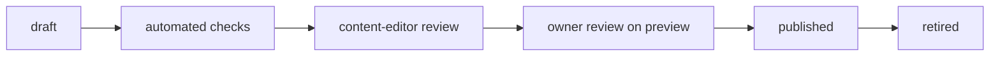

> Archived. Not in force. This file belongs to the original ten-phase plan and is kept for work after the first release. Do not build from it unless the owner says so. The plan in force is in `docs/spec/`.

# 04 Content System

How lessons are structured, tested, reviewed, and published. Lessons are the product. The code exists to deliver them and to make a pass trustworthy.

## 1. Layout

```
content/
  registry.json                    Append-only record of every ID ever issued
  courses/
    python/
      course.yaml
      01-say-something/
        chapter.yaml
        01-print/
          lesson.md                Frontmatter plus body
          starter/main.py          What the learner sees first
          solution/main.py         Reference solution
          wrong/fixed-text.py      A named wrong answer
          tests.yaml
          checks/                  Optional author-written checks for `custom` tests
          assets/                  Images used by this lesson
```

Folder prefixes (`01-`) set order and are not part of URLs or IDs. Web lessons use `index.html` and `style.css` in `starter/`, `solution/`, and each `wrong/<name>/`.

## 2. Schemas

All files are validated by schemas in `packages/content`. An invalid file fails the build and names the file and field (FR-CNT-01).

### 2.1 `course.yaml`

| Field | Rule |
|---|---|
| `id` | Immutable, from the registry. Example `python`. |
| `slug` | URL segment. |
| `title`, `summary` | `summary` is one sentence, at most 140 characters. |
| `level` | `beginner` or `intermediate`. |
| `language` | `python` or `web`. Selects the runner. |
| `outcomes` | Three to five things the learner will be able to do. Each starts with a verb. |
| `unlock` | `chapter-open` (default) or `linear`. |

Estimated time is never written by hand. It is the sum of the lessons' `minutes`.

### 2.2 `chapter.yaml`

`id` (immutable), `title`, `summary` (one sentence).

### 2.3 `lesson.md` frontmatter

| Field | Rule |
|---|---|
| `id` | Immutable, issued by `content:new`. Never edited, never reused. |
| `slug` | URL segment. Changing it requires adding the old value to `previous_slugs`. |
| `previous_slugs` | Old slugs that must redirect. |
| `title` | At most 40 characters. |
| `kind` | `guided`, `challenge`, or `build`. |
| `status` | `draft`, `published`, or `retired`. |
| `access` | `free` or `paid`. |
| `xp` | Integer. Defaults: guided 10, challenge 15, build 25. |
| `minutes` | Honest estimate for a beginner. |
| `content_version` | Integer. Raise it when a change could make previously passing code fail. |
| `time_limit_seconds` | Optional. Default 5, maximum 20. |

### 2.4 Lesson body

Sections are level-two headings, in this order.

| Kind | Sections |
|---|---|
| `guided` | `Concept`, `Watch out` (optional), `Your task`, `Hints` (optional) |
| `challenge` | `Problem`, `Examples`, `Constraints` (optional), `Hints` (optional) |
| `build` | `Brief`, `Requirements`, `Hints` (optional) |

`Hints` is an ordered list. The workspace reveals one item at a time.

Allowed Markdown: paragraphs, emphasis, inline code, fenced code with a language, lists, tables, level-three headings, images from the lesson's `assets/` with alt text, `https` links. Directives: `:::note`, `:::warning`, `:::output` (what a program prints). Raw HTML is not allowed and is stripped by the sanitizer.

## 3. Tests

`tests.yaml` has a `version`, a list of `tests`, and a list of `wrong_answers`.

```yaml
version: 1
tests:
  - id: greets-sara
    name: Greets Sara by name
    kind: io
    stdin: "Sara\n"
    stdout: "What is your name? Hello, Sara!"
    hint: Use the name that was typed, not a fixed name.
  - id: greets-another-name
    name: Works for a different name
    kind: io
    stdin: "Omar\n"
    stdout: "What is your name? Hello, Omar!"
    hidden: true
  - id: asks-with-input
    name: Asks for the name with input()
    kind: source
    uses: ["call:input"]
    hint: Read the name with input().
wrong_answers:
  - file: wrong/fixed-text.py
    why: Prints a fixed name instead of reading one.
    must_fail: [greets-another-name, asks-with-input]
```

This exact lesson was run in the prototype: the solution passed all tests, the fixed-text answer passed the first test and failed the other two, and the empty starter failed all three (E-06). One visible test alone would have accepted the wrong answer.

### 3.1 Common fields

| Field | Rule |
|---|---|
| `id` | Unique in the lesson, kebab case. |
| `name` | What the learner reads. Written as a requirement: "Prints the total on one line". |
| `kind` | See below. |
| `hint` | Shown when this test fails. Says what to look at, never the answer. Required for visible tests. |
| `hidden` | Default false. A hidden test shows its name and verdict only. Because grading runs in the browser, hidden means not displayed, not secret (ADR-0007). |

### 3.2 Python kinds

| Kind | Fields | Passes when |
|---|---|---|
| `io` | `stdin` (default empty), `stdout`, `match`, `float_tolerance`, `seed` | The program's output matches `stdout` under the comparison mode. |
| `variable` | `stdin`, `var`, `equals`, `type`, `float_tolerance` | After the program runs, the variable exists with that value and type. |
| `call` | `function`, `cases` (each with `args`, `kwargs`, `returns`, optional `stdout`) | The function exists and every case returns the expected value. |
| `source` | `uses`, `forbids` | The syntax tree contains every `uses` fact and none of the `forbids` facts. |
| `custom` | `file`, `function` | An author-written Python function in `checks/` returns a pass. For cases the other kinds cannot express, such as output that depends on random choice. |

`source` facts use a fixed vocabulary checked on the syntax tree, never on text: construct names (`for`, `while`, `if`, `def`, `return`, `fstring`), `call:<name>`, `def:<name>`, `import:<module>`, `op:<symbol>`.

### 3.3 Web kinds

| Kind | Fields | Passes when |
|---|---|---|
| `dom` | `selector`, then one of `exists`, `count`, `text`, `attr`, `inside`, `order` | The rendered document satisfies the assertion. |
| `style` | `selector`, `property`, `equals` or `one_of` | The computed style matches. Colors are compared as `rgb()` or `rgba()`, lengths in pixels. |
| `source` | `uses`, `forbids` | The parsed source contains the facts: `tag:<name>`, `attr:<name>`, `doctype`, `css-property:<name>`, `css-selector:<text>`. |
| `custom` | `file`, `function` | An author-written JavaScript function in `checks/` returns a pass. |

### 3.4 Comparison

| Mode | Rule |
|---|---|
| `normalized` (default) | Line endings unified; trailing whitespace removed from each line; trailing blank lines removed. Leading whitespace and letter case are significant. |
| `exact` | Byte for byte. |
| `contains` | Expected text appears in the output after normalization. |
| `regex` | Whole normalized output matches the pattern. |

`float_tolerance` compares numbers found in the same positions within the tolerance.

When a comparison fails, the harness classifies near misses so the message can be specific: differs only in letter case, only in spaces, only in punctuation, or by a missing final line. Beginners cannot see these differences; the product must name them (FR-WSP-05).

### 3.5 Wrong answers

Every lesson lists at least one wrong answer, the reason it is wrong, and the tests that must catch it. Good wrong answers are the mistakes learners really make: hard-coding the example's output, an off-by-one loop, a missing conversion, the right output through the wrong construct when the lesson is about the construct.

`content:check` fails if a wrong answer passes all tests, or if a listed test does not fail it.

## 4. Harnesses

Both live in `packages/grader`. Both are trusted code that runs next to untrusted code, so both are small, dependency-free, and heavily tested.

### 4.1 Python harness

- Pure Python, standard library only. The same files run under CPython in unit tests and inside Pyodide in CI and browsers. The prototype ran one harness file unchanged in all three (E-04, E-06).
- Unit-tested with pytest on CPython for speed, then cross-checked in Pyodide under Node by the parity suite (FR-GRD-04).
- Implements run isolation as specified in `02-architecture.md` section 5.5.
- Returns structured results only. It never raises to the caller.
- Versioned. The version is included in every result and in lesson feedback.

### 4.2 Web harness

- One script that runs inside the sandbox document. No dependencies.
- Waits for the document to finish loading, runs assertions, posts results to the parent, and cancels navigation attempts.
- Unit-tested in a real browser through the sandbox, in three engines.

### 4.3 Node runner

`packages/grader` also exports a runner that executes the Python harness in Pyodide inside a Node worker thread, with the same time limit behavior as the browser (terminate on limit). `content:check` and the parity suite use it. Prototype timings: start about 1.8 s, three tests in about 2 ms, runaway loop terminated at its limit, memory exhaustion reported as an error with the runtime still alive (E-04).

## 5. Commands

| Command | Does |
|---|---|
| `pnpm content:new <course> <chapter> <slug> --kind <kind>` | Creates the lesson folder from a template, issues an ID, appends it to the registry. |
| `pnpm content:check [path]` | For each lesson: solution passes every test; starter fails at least one; every wrong answer fails as declared; time limits hold. Web lessons run in a headless browser. |
| `pnpm content:lint [path]` | Spelling against a project dictionary, section order, heading levels, image alt text, link reachability, reading length, banned phrasing, code samples that do not parse. |
| `pnpm content:sync --env <name>` | Upserts the catalog into the database for that environment. Marks removed lessons retired. Idempotent. |
| `pnpm content:stats` | Lesson counts, minutes, and XP per course and chapter, for review. |

`content:check` and `content:lint` are required checks on every pull request that touches `content/`.

## 6. Registry

`content/registry.json` records every course, chapter, and lesson ID with the date it was issued. CI compares it with the previous commit: entries may be added; an entry may gain `retired: true`; nothing may be edited or removed (FR-CNT-02). Progress in the database refers to these IDs forever.

## 7. Editorial workflow



1. The author runs `/author-lesson` (or `content:new`) and writes the lesson with `status: draft`.
2. `content:check` and `content:lint` pass.
3. The `content-editor` subagent reviews against the rubric below and reports findings.
4. The owner reads and tries the lesson on the preview deployment, where drafts are visible and marked.
5. The owner approves the pull request that changes `status` to `published`.
6. A lesson that should disappear is set to `retired`: it leaves the outline, its URL redirects to the course page, and completions and XP remain.

### 7.1 Review rubric

A lesson passes when every answer is yes.

- Does it teach exactly one new idea, and is that idea named in the first two sentences?
- Is there a runnable example before the task?
- Can the task be solved with only what this lesson and earlier lessons taught?
- Would a learner know they are done from the task text alone?
- Do the test names read as the task's requirements?
- Does each hint help without giving the answer? Does the last hint make the task reachable for a stuck learner?
- Do the wrong answers represent mistakes a real beginner makes?
- Is every sentence needed? Is the reading length within budget?
- Is every factual claim true and checkable?
- Is every example suitable for the audience (section 8)?

## 8. Writing lessons

### 8.1 Teaching approach

This follows how the owner teaches.

- **Light theory.** `Concept` is at most 150 words before the first code sample and at most 300 words in total. If it needs more, it is two lessons.
- **Show, then ask.** Every idea appears first as code the learner can run.
- **One idea per lesson.**
- **Building blocks.** Each guided lesson in a chapter adds one block. The chapter's `build` lesson introduces nothing new: the learner assembles the blocks into a small program by themselves, for example arithmetic lessons leading to a calculator.
- **Small programs, not numbered drills.** A task makes something a person might want: a greeting, a receipt, a score counter.
- **Hints in three steps.** A nudge, then the construct to use, then the outline of the answer. The solution is separate and optional.
- **Why before how.** One sentence on when a learner would use the idea.

### 8.2 Style

- English for a reader who learned it as a second language. Short sentences. Define each programming term the first time, and use the same term every time after.
- Second person, present tense. No idioms, no sarcasm.
- Python: PEP 8, four spaces, double quotes, descriptive English names.
- HTML and CSS: lowercase tags and properties, two spaces, double-quoted attributes.
- Output shown in a lesson is the real output of the code shown.
- Run lesson copy through `antislop-copywriting`. No em dashes, no filler openers, no praise that says nothing.

### 8.3 Suitable examples

The audience is young people in the Gulf, and their families may read over their shoulder.

- No gambling, alcohol, or dating themes. This rules out common beginner exercises such as slot machines and fortune games.
- Prefer everyday things: a coffee order, a football score, exam grades, a shopping list, a travel time, a phone battery.
- Use names common in the region alongside others. Use the local currency where money appears.
- No real brands, public figures, or current events.

## 9. Curriculum proposal

A proposal for the owner to edit in WP-4.6. Nothing here is final. Each chapter ends in a build.

### 9.1 Python Foundations

| # | Chapter | Ideas | Build |
|---|---|---|---|
| 1 | Say something | `print`, strings, comments | A text business card |
| 2 | Remember things | variables, numbers, types, conversion | A receipt with a total |
| 3 | Ask and calculate | `input`, arithmetic, f-strings | A calculator |
| 4 | Decide | booleans, comparisons, `if`, `elif`, `else` | A grade checker |
| 5 | Repeat | `while`, `for`, `range`, `break` | Guess the number |
| 6 | Collect | lists, indexes, looping over lists | A shopping list |
| 7 | Reuse | functions, parameters, `return` | A quiz |

Seven chapters match the seven blocks of the heap mark (see `03-experience.md` section 9.6). About four guided lessons, one or two challenges, and one build per chapter.

### 9.2 HTML and CSS Foundations

| # | Chapter | Ideas | Build |
|---|---|---|---|
| 1 | Your first page | elements, headings, paragraphs | An about-me page |
| 2 | Structure | document skeleton, lists, links, images | A recipe page |
| 3 | First styles | rules, selectors, color, type | A styled profile |
| 4 | The box | padding, border, margin, size | A card |
| 5 | Layout | flexbox basics | A one-page site |

### 9.3 Pilot content

Written in WP-4.6 to prove the system end to end before the full courses are produced: Python chapters 1 and 2, and HTML and CSS chapter 1. Between them the pilot lessons must exercise every test kind, every comparison mode, a lesson with `input()`, a lesson with a raised time limit, a multi-file web lesson, a challenge, and a build.

## 10. Content track

Lesson production runs beside engineering from Phase 4 onward. It is planned in batches of one chapter. A batch is done when every lesson in it is published. The launch scope (which chapters of which course) is the owner's decision at the Phase 5 gate, with real numbers from `content:stats`.
