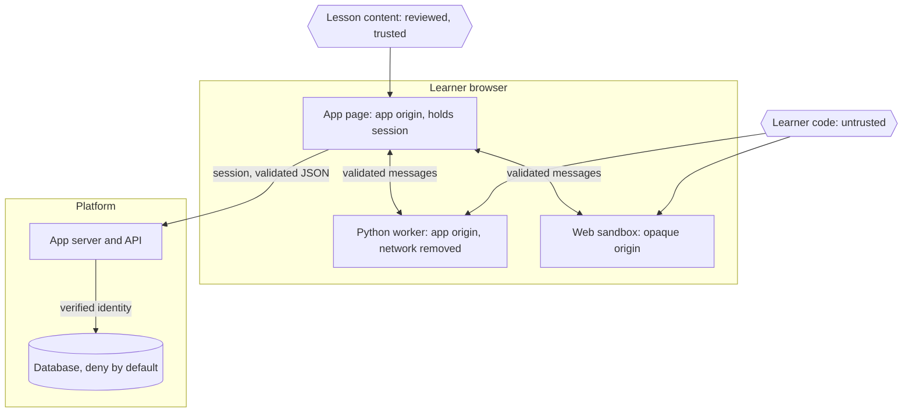

> Archived. Not in force. This file belongs to the original ten-phase plan and is kept for work after the first release. Do not build from it unless the owner says so. The plan in force is in `docs/spec/`.

# 06 Security and Privacy

The product runs code written by strangers, in a browser that also holds their session. That is the security problem. This document names what is protected, what can go wrong, what stops it, and the test that proves it.

It is not legal advice. Section 8 lists what a qualified person must review before launch.

## 1. Objectives

1. Code written by a learner cannot read or change anything it should not: the app's session, other learners' data, the page around it.
2. A learner can read and change only their own data.
3. Paid material reaches only entitled learners.
4. Secrets stay out of the repository, the browser, logs, and telemetry.
5. The build and its dependencies are what we think they are.
6. Only the minimum personal data is held, and it can be deleted.

## 2. Assets

| Asset | Why it matters |
|---|---|
| Session cookies | Whoever holds them is the learner. |
| Personal data: email, display name, time zone, progress, drafts | Privacy and trust. |
| Paid lesson material and all solutions | The business, later. |
| Server secrets: database secret key, provider keys | Full control of data. |
| The integrity of a pass | The product's reason to exist. |
| The deployment pipeline | Control of what learners run. |

## 3. Trust boundaries

Untrusted: learner code, everything typed by a learner, every request. Trusted after review: lesson content, harness code, dependencies pinned by the lockfile.

## 4. Threats and controls

Each row has a test. A control without a test is a hope.

| ID | Threat | Controls | Verified by |
|---|---|---|---|
| T-01 | Python that a learner was tricked into pasting uses the learner's session (same-origin requests from the worker) or sends data elsewhere. | After start-up the worker removes network and spawning APIs (`fetch`, `XMLHttpRequest`, `WebSocket`, `EventSource`, `Worker`, and related) from its global scope and prototype chain. The worker script's response carries a policy with `connect-src 'self'` and no `unsafe-eval`. Destructive account actions require a recent sign-in. No feature runs code written by another user. | Runtime test: from Python, `js.fetch` and known recovery paths are unavailable, and evaluating JavaScript is refused (prototype result in E-07). API test for recent sign-in. |
| T-02 | Learner code freezes or crashes the tab. | Worker isolation, external watchdog, output cap, memory error handling, automatic restart. | J-4; fault fixtures (loop, print flood, memory bomb). |
| T-03 | Learner HTML or CSS reads cookies, storage, or the app's DOM. | Opaque-origin sandbox document. | Sandbox tests in three engines: each access throws. |
| T-04 | The sandbox document is opened directly, or framed by another site, to run markup with the app's origin. | Its response policy begins with `sandbox allow-scripts` and sets `frame-ancestors 'self'`. The harness also refuses to act unless its origin is opaque and its parent completes a handshake. | Direct navigation test: origin is `null`, storage throws (E-07). Cross-site framing test. |
| T-05 | The preview navigates away, opens windows, submits forms, or imitates the app. | Containment controls in `02-architecture.md` section 6.4. The preview has a visible frame and label. | Containment matrix: link, targeted link, form, meta refresh, download attribute. |
| T-06 | Script injected through lesson content. | No raw HTML in Markdown; allowlist sanitizer at build time; one component renders lesson HTML; content is reviewed. | Malicious fixture lessons: every payload is neutralized in the build output. |
| T-07 | Script injected through learner-controlled strings shown in the UI: console output, expected and actual values, display name, feedback text. | Rendered as text by the framework. No HTML sink is used for these, enforced by a lint rule. Control characters and terminal escape sequences are stripped from console output. | Component tests with injection payloads. |
| T-08 | Reading or changing another learner's data. | Identity from verified claims only. Repositories require a verified user ID. Row level security denies by default. | pgTAP policy tests for every table and operation; API tests that substitute another user's IDs. |
| T-09 | Paid material leaks through static output, shared caches, client bundles, or an unguarded endpoint. | Paid material is never emitted statically in any access mode. Gated responses are `Cache-Control: private, no-store`. One policy function. | Canary test: a fixture paid lesson contains a unique token; CI searches the entire build output and every response available to guest and free sessions for the token and must not find it. |
| T-10 | Forged completions or XP. | Accepted by design (ADR-0007). Bounded: XP comes from the catalog, completions are idempotent, entitlement is checked. Nothing of monetary value depends on XP in 1.0. | API tests for bounds and idempotence. |
| T-11 | Sign-in abuse: open redirect, cross-site request forgery, code guessing, email flooding, account enumeration. | Return path allowlist. PKCE. Same-origin check on mutating routes plus `SameSite` cookies. Provider rate limits. Bot challenge on code requests. Identical responses whether or not an email is registered. | Dedicated tests for each. |
| T-12 | Secrets exposed in the repository, the client bundle, logs, or CI output. | One environment schema separates public and server variables. A build check searches client bundles for server variable names and values. Secret scanner on commits and in CI. Log redaction. | Build check and scanner are required checks. |
| T-13 | Supply chain: a compromised package, action, or runtime file. | Frozen lockfile. Minimum release age for updates. Install scripts denied unless allowlisted. CI actions pinned by commit. Runtime files come from the locked package, served by us. Dependency audit. A software bill of materials per release. | Required checks; nightly audit. |
| T-14 | Abuse and cost: request floods, feedback spam, oversized drafts. | Rate limits per route class, at the edge by network address and in the handler by user. Size limits in schemas and database constraints. Challenge on anonymous feedback after a threshold. Spend alerts. | Limit tests; load test. |
| T-15 | Clickjacking. | `frame-ancestors 'none'` on every app page. | Header test. |
| T-16 | Personal data or learner code in telemetry or logs. | Event properties are an allowlist in the typed analytics function. Error reports scrub request bodies and local variables. Session recording is off. | Unit tests on the scrubber; review of every event schema. |
| T-17 | Deletion leaves data behind. | Cascading deletes from the auth user. Deletion test inspects every table. Backup retention is stated in the privacy policy. | J-10 with database assertions. |
| T-18 | The implementing agent runs a destructive command or handles a secret it should not have. | Production credentials exist only in the CI production environment, which requires the owner's approval. They are never on the development machine. Layer 2 and layer 3 controls from the handbook. | WP-0.2 demonstrates each block. Access review at each gate. |

## 5. Baseline controls

### 5.1 Response headers

| Response | Policy |
|---|---|
| Every app page and API response | `Strict-Transport-Security` with a long max-age; `X-Content-Type-Options: nosniff`; `Referrer-Policy: strict-origin-when-cross-origin`; a restrictive `Permissions-Policy`; content security policy per 5.2. |
| Worker scripts | A content security policy with `script-src 'self' 'wasm-unsafe-eval'` and `connect-src 'self'`. A worker loaded from a URL takes its policy from its own response, not from the page. |
| Sandbox document and script | The sandbox policy in `02-architecture.md` section 6.3. |
| Runtime assets | Immutable caching; `nosniff`. |
| Gated lesson responses | `Cache-Control: private, no-store`. |

### 5.2 Content security policy for the app

Fixed for every route: no `unsafe-eval`; `object-src 'none'`; `base-uri 'none'`; `frame-ancestors 'none'`; `form-action 'self'`; explicit allowlists for `connect-src`, `frame-src`, `worker-src`, `img-src`, and `font-src`; `'wasm-unsafe-eval'` only where the Python runtime loads.

The script policy depends on how the framework renders the route, and this is a real constraint. In the Next.js version current at the time of writing, a per-request nonce requires dynamic rendering and turns off static generation; the alternative for static pages is either inline scripts allowed or an experimental build-time integrity feature (E-01). So:

| Route class | Script policy |
|---|---|
| Per-user and sensitive routes: sign-in, auth callback, profile, gated lesson views | Per-request nonce with `strict-dynamic`. These routes are dynamic anyway. |
| Static public routes: landing, catalog, course pages, free lessons | Decided in WP-2.5 and recorded in ADR-0021. First choice: build-time hashes or integrity if the framework supports it reliably. Fallback: inline scripts allowed, compensated by the absence of any HTML injection sink (lint-enforced), strict values for every other directive, and Trusted Types where the browser supports it. The fallback is an accepted risk that needs the owner's signature. |

A policy is first deployed in report-only mode in Phase 1 and enforced from Phase 8, with a report endpoint.

### 5.3 Authorization

- The server derives the user from verified claims on every request. No handler accepts a user ID from the client.
- Read paths use the user-scoped database client, so row level security applies even if a query forgets a filter.
- Write paths go through repositories that take a verified user ID and use the privileged client. The privileged client is created in one module; a lint rule forbids importing it elsewhere.
- Every new table ships with its policies and pgTAP tests in the same migration.

### 5.4 Input and output

- Every request body, query, and path parameter is parsed by a schema with length and size limits. Unknown fields are rejected.
- Every message from a worker or iframe is parsed by a schema before use.
- Lesson IDs from clients are checked against the catalog.
- Text from learners is stored and rendered as text.

### 5.5 Secrets and environments

- Three sets of credentials: local (throwaway), staging, production. They never mix.
- Production secrets live only in the hosting provider and the CI production environment.
- `.env.example` documents every variable with a description and a fake value. Real `.env` files are ignored by Git and unreadable to the implementer by permission rule.
- Keys are rotated when a person or machine with access leaves, and after any suspected exposure. The runbook has the steps.

### 5.6 Verification beyond tests

- Static analysis and dependency audit on every pull request.
- A baseline dynamic scan against staging at the Phase 8 gate.
- The `security-reviewer` subagent reviews every change in the areas listed in the handbook.
- A manual review of this threat table at each gate: are the controls still true, are there new threats.

## 6. Residual risks

Accepted knowingly. Each is recorded in an ADR and revisited at the trigger.

| Risk | Why accepted | Trigger to revisit |
|---|---|---|
| Completions and XP can be forged by a learner who calls the API directly. | Verifying correctness needs server-side execution, which 1.0 excludes. Nothing of value depends on XP. | Certificates, competitions, or rewards. |
| The Python worker shares the app's origin. Removing network APIs is hardening, not a boundary. | An opaque-origin host for the worker is a larger build. The realistic harm is limited to the learner's own account, and destructive actions need a fresh sign-in. | Any feature that runs code not written by the current learner. Then the worker moves into an opaque-origin host first. |
| Hidden tests are visible to anyone who inspects network traffic. | Same reason as the first row. | Same. |
| Static public routes may allow inline scripts (see 5.2). | Framework constraint. | The framework supports strict policies on static pages. |
| Guest progress can be lost if the browser clears storage, which some in-app browsers do. | Storing guest data on the server would create rows for every visitor. | Field data shows meaningful guest loss. |

## 7. Privacy

### 7.1 Data inventory

| Data | Purpose | Where | Kept |
|---|---|---|---|
| Email address | Sign-in | Auth provider | Until account deletion |
| Display name | Shown to the learner | Database | Until deletion |
| Time zone | Streak days | Database | Until deletion |
| Completions, active days | Progress | Database | Until deletion |
| Drafts (the learner's code) | Restore work | Database, browser | Until deletion or overwrite |
| Lesson feedback | Fix lessons | Database | 24 months, then deleted (proposed). Detached from the account on deletion. |
| Product events | Improve the product | Analytics vendor | Vendor retention, set to the shortest practical |
| Error reports | Fix defects | Error vendor | Vendor retention, 90 days or less (proposed) |
| Server logs | Operate the service | Hosting provider | Provider default |

Nothing else is collected. No advertising identifiers, no contact lists, no location beyond what a time zone implies.

### 7.2 Principles

- Guests are not tracked across sessions on the server. Guest progress stays in the browser.
- Analytics uses first-party storage only, respects Do Not Track and Global Privacy Control, and carries no email, name, code, or free text.
- Accounts can be exported and deleted by the learner, without contacting anyone.
- Processors (hosting, database and auth, email, errors, analytics, bot challenge) are listed in the privacy policy.

## 8. For the legal reviewer

The owner arranges this review before the Phase 9 gate. The implementer prepares drafts and the data inventory; it does not decide these questions.

1. Which laws apply. The audience is largely in Saudi Arabia and the wider Gulf, so the Saudi Personal Data Protection Law is the starting point; visitors from the European Union and elsewhere may bring others.
2. Where data is stored and whether cross-border transfer rules are met by the chosen database region and vendors.
3. Minimum age and what consent is needed for learners under 18.
4. Whether analytics as configured needs consent or a notice.
5. The privacy policy, terms of use, and the text shown at sign-up.
6. Retention periods, including backups.
7. What must happen, and how fast, if personal data is exposed.
