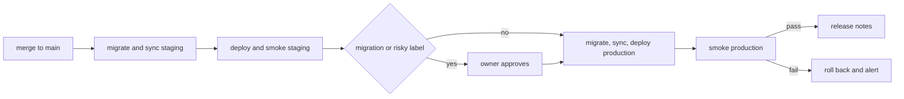

> Archived. Not in force. This file belongs to the original ten-phase plan and is kept for work after the first release. Do not build from it unless the owner says so. The plan in force is in `docs/spec/`.

# 07 Operations

How the product is built, shipped, watched, recovered, and paid for. One person operates it, so everything here favors automation, written steps, and early warnings.

## 1. Environments

| Environment | App | Database and auth | Data | Purpose |
|---|---|---|---|---|
| Local | Dev server | Supabase local stack in containers | Seed data, throwaway | Development and most tests |
| Preview | One deployment per pull request | Staging project | Seeded test accounts | Review by the owner; drafts visible |
| Staging | Latest `main` before promotion | Staging project | Same | Final smoke before production |
| Production | Live site | Production project | Real | Learners |

- Two Supabase projects, staging and production. The free plan allows two active projects (E-11).
- Preview deployments sign in against staging. Their URLs must be covered by the auth provider's redirect allowlist; configure a pattern for the preview domain, not individual URLs.
- Configuration is validated at build and at start (`02-architecture.md` section 15). `.env.example` is the list of record.

### 1.1 Configuration as files

Where a vendor supports configuration in the repository, it is used: database schema and policies as migrations, auth and local stack settings in the Supabase config file, hosting settings in the project config file, pipeline definitions as workflow files. Settings that exist only in a dashboard are listed step by step in `docs/runbooks/infrastructure-setup.md`, and a script (`pnpm infra:verify`) checks what can be checked from outside: response headers, redirect behavior, health endpoints, required environment variables, DNS.

## 2. Continuous integration

### 2.1 Pull request pipeline

Jobs run in parallel after a path filter decides which are needed. All listed jobs are required checks when they run.

| Job | Does | Needed when |
|---|---|---|
| `static` | Format, lint, types, dead code, dependency rules, commit messages, AI attribution check (handbook section 4.1), secret scan | Always |
| `unit` | Unit, component, and contract tests with coverage | Code changes |
| `python` | pytest for the Python harness | `packages/grader` changes |
| `content` | `content:check`, `content:lint`, registry check | `content/` or `packages/grader` or `packages/content` changes |
| `database` | Start local stack, apply all migrations from zero, lint, pgTAP | `supabase/` changes |
| `build` | Production build, bundle budgets, OpenAPI drift, server-secret-in-bundle check, canary leak check | Code or content changes |
| `e2e-smoke` | Core journeys and axe on desktop Chromium and mobile WebKit against the built app and local stack | Code or content changes |
| `lighthouse` | Lighthouse CI against the built app | Code or content changes |
| `visual` | Screenshot comparison for changed stories | UI changes |

The workflow also runs when a pull request's title or description is edited, so the attribution check always sees the final text.

Rules for workflow files: actions pinned by commit; least-privilege token permissions per job; a timeout on every job; concurrency groups that cancel superseded runs; dependency and browser caches; no secret available to pull request jobs beyond what the staging preview needs.

Budget: the pipeline finishes within 12 minutes at the 95th percentile (NFR-MAINT-06). CI minutes are finite on a private repository; the nightly matrix is sized to stay within the plan, and usage is reviewed at each gate.

### 2.2 Scheduled

| When | Job |
|---|---|
| Nightly | Full end-to-end matrix (Chromium, Firefox, WebKit, two phone profiles); runtime integration in three engines; parity suite; mutation tests; full visual comparison; dependency audit; lesson link check; encrypted database backup |
| Weekly | Dependency update pull requests, grouped |
| Monthly | Restore drill reminder issue; access review reminder issue |

A failed scheduled job opens or updates an issue automatically.

## 3. Delivery

`main` is always deployable. A merge to `main` goes to production through one ordered workflow. The hosting provider's automatic production deploy is turned off so that the order below is guaranteed.

1. Apply migrations to staging. Run catalog sync. Deploy the build to staging. Run the smoke suite.
2. If the change contains a migration or carries the `risky` label, wait for the owner's approval in the production environment gate. Otherwise continue.
3. Apply migrations to production. Run catalog sync. Deploy the same build artifact that passed staging.
4. Smoke production: health and readiness, the landing page, one free lesson page, one runtime asset, one sandbox asset, response headers.
5. On failure, promote the previous deployment and alert the owner. On success, update release notes.

### 3.1 Database changes

- Forward-only migrations. An applied migration is never edited.
- **Expand, then contract.** A change that the previous app version could not work with is split: first add (new columns, tables, nullable or defaulted), deploy code that uses both, then remove in a later release. Every migration's pull request states whether the previous app version still works with it.
- Migrations are tested from an empty database and against a schema snapshot of production.
- No long locks: indexes are created concurrently; backfills are batched.

### 3.2 Rollback

- App: promote the previous deployment. Target: within 5 minutes (NFR-REL-04). Drilled at the Phase 1 gate and again before launch.
- Database: not rolled back. Because of expand and contract, the previous app version works against the new schema. A bad migration is fixed forward.
- Content: revert the content commit and redeploy; catalog sync retires or restores lessons.

## 4. Observability

### 4.1 Logs

Structured JSON from the server with: timestamp, level, request ID, route, method, status, duration, outcome code, user presence (yes or no, never the ID in plain form), release. No bodies, no emails, no code.

### 4.2 Errors

Client and server errors go to the error reporter port with release and environment. Source maps are uploaded at build and not served publicly. Runtime crashes inside the Python worker or the sandbox are reported with the lesson ID, harness version, and browser family, never with the learner's code.

### 4.3 Product events

Emitted only through the typed `track()` function. Property names and types are fixed in code; anything else fails type checking. No free text, no code, no email.

| Event | Properties |
|---|---|
| `landing_run_clicked` | |
| `lesson_opened` | `lesson_id`, `course_id`, `kind`, `viewer_tier` |
| `runtime_load_started` | `runtime`, `cache_state` |
| `runtime_ready` | `runtime`, `duration_ms`, `cache_state`, `input_strategy` |
| `runtime_failed` | `runtime`, `reason` |
| `runtime_restarted` | `reason` |
| `run_finished` | `lesson_id`, `outcome_kind`, `duration_ms`, `used_input` |
| `check_finished` | `lesson_id`, `passed`, `tests_total`, `tests_failed`, `attempt_number` |
| `lesson_completed` | `lesson_id`, `attempts`, `assisted`, `seconds_since_open` |
| `hint_revealed` | `lesson_id`, `hint_index` |
| `solution_revealed` | `lesson_id` |
| `code_reset` | `lesson_id` |
| `save_prompt_shown`, `save_prompt_accepted`, `save_prompt_dismissed` | |
| `signin_started`, `signin_completed`, `signin_failed` | `method`, `in_app_browser`, and for failures `reason` |
| `guest_merge_completed` | `completions_merged` |
| `sync_pending`, `sync_recovered` | `queued_items` |
| `feedback_sent` | `lesson_id`, `category` |
| `unsupported_browser_shown` | `reason` |

These answer the questions in the charter's success measures and show where learners get stuck: lessons with many attempts, many hints, many resets, or many feedback reports.

### 4.4 Real-user performance

Core Web Vitals and the runtime timings above are collected from real sessions and split by device class and cache state.

## 5. Service levels

Targets marked proposed are confirmed after two weeks of production data and then recorded in an ADR.

| ID | Objective | Target | Measured by |
|---|---|---|---|
| SLO-1 | The landing page and a free lesson page respond successfully. | 99.5 percent of checks in 30 days | External check every 5 minutes |
| SLO-2 | The Python runtime loads when asked. | 99 percent of attempts in 7 days | `runtime_ready` against `runtime_failed` |
| SLO-3 | Time from lesson open to runtime ready, 75th percentile. | Warm 2.5 s. Cold on mobile: proposed after baseline. | `runtime_ready.duration_ms` |
| SLO-4 | Progress API calls succeed, and are fast. | 99.5 percent success; 95th percentile 800 ms (proposed) | Server metrics |
| SLO-5 | No completion stays unsynced for more than 24 hours. | Zero | `sync_pending` without `sync_recovered` |

### 5.1 Alerts

Alerts go to the owner's phone and email. Each alert names its runbook.

| Condition | Severity |
|---|---|
| SLO-1 check fails twice in a row | High |
| `runtime_failed` above 5 percent for 15 minutes | High |
| API errors above 2 percent for 10 minutes | High |
| A new release doubles the error rate within 30 minutes | High; roll back first |
| Database above 80 percent of plan storage; email sends above 80 percent of the daily cap; spend above the monthly alert line | Medium |
| A scheduled job failed | Low |

## 6. Backup and recovery

- Nightly logical backup of the production database from CI, encrypted to a key only the owner holds, kept 30 days, with one weekly copy kept 90 days. This exists because free-plan backups cannot be downloaded (E-11). On the paid plan the provider's daily backups are an additional copy.
- Lesson content, schema, and configuration are in Git, which is its own backup.
- Recovery point objective 24 hours. Recovery time objective 4 hours.
- **Restore drill**: restore the latest backup into a local stack, run the verification script (table counts, a known test account's progress, policy checks), record the time taken. Done before launch and every quarter. A backup that has never been restored is not a backup.

## 7. Rate limits

Starting values, tuned with production data. Limits keyed by network address are enforced at the edge; limits keyed by user are enforced in the API handler wrapper; database constraints are the last line.

| Class | Routes | Limit |
|---|---|---|
| `auth-code` | Email code request | 3 per 10 minutes per address and per network address, plus the provider's own limits |
| `progress-write` | Completions, merge | 60 per minute per user |
| `draft` | Draft save | 30 per minute per user; the client saves at most once every few seconds |
| `gated` | Paid lesson payload and solution | 60 per minute per user |
| `read` | Other authenticated reads | 120 per minute per user |
| `feedback` | Lesson report | 5 per hour per user or network address |

Provider settings to configure before launch: a custom email sender (the built-in one is limited to 2 emails per hour, E-11), sign-in rate limits, bot challenge on code requests, code lifetime, and the email template that shows a code.

## 8. Incidents

| Severity | Meaning | Response |
|---|---|---|
| S1 | Learners cannot open or run lessons, or data is at risk | Act immediately. Roll back first, investigate second. Post a site notice. |
| S2 | A major feature is degraded: sign-in, sync, one runtime | Same day. Site notice if learners are affected. |
| S3 | Minor defect or a single lesson | Next working session. |

Every S1 and S2 gets a short, blameless write-up in `docs/reports/incidents/`: timeline, cause, what limited the damage, what will change. Action items become issues.

### 8.1 Runbooks

Each is a numbered procedure in `docs/runbooks/`, written in the phase that introduces the thing it covers, and exercised once before launch.

| Runbook | Written in |
|---|---|
| Infrastructure setup from zero | Phase 1 |
| Deploy and roll back | Phase 1 |
| Migration failed midway | Phase 6 |
| Restore from backup | Phase 8 |
| Database provider paused or unavailable | Phase 6 |
| Runtime or sandbox assets unreachable | Phase 5 |
| Sign-in or email provider outage | Phase 6 |
| A published lesson's tests are wrong | Phase 4 |
| Rotate a secret | Phase 6 |
| Post and remove a site notice | Phase 8 |
| Spend or usage spike | Phase 8 |
| A learner asks by email to delete their data | Phase 8 |

## 9. Cost and vendor limits

Facts checked on 2026-11-13 (see `09-evidence.md`). Prices and limits change; the owner confirms them before paying.

| Vendor | Plan needed | Why | Watch |
|---|---|---|---|
| GitHub | A paid personal plan | Branch protection on a private repository is not available on the free plan (E-14). | CI minutes included in the plan |
| Vercel | Pro, 20 US dollars per month per developer seat | The free plan is limited to non-commercial use, and a site that advertises a paid community is commercial (E-13). | Data transfer |
| Supabase | Free to start; Pro at 25 US dollars per month for production from the closed beta onward | Free projects pause after a week of low activity and have no downloadable backups (E-11). Free includes 50,000 monthly active users and a 500 MB database. | Monthly active users, database size, egress |
| Email provider | A plan whose daily cap exceeds the expected launch-day email sign-ins | Required for sign-in codes. | Daily and monthly send caps, deliverability |
| Bot challenge, error tracking, analytics | Free tiers to start | | Event and error volume caps |
| Domain | | | Renewal |

### 9.1 The one cost that scales with success

The Python runtime is about 5.5 MB per new learner with Brotli, 6.4 MB with gzip (E-02). It is cached permanently after the first visit. Ten thousand new learners in a month is about 55 to 64 GB of transfer. This is the number to watch on the hosting bill after a video does well.

### 9.2 Scale triggers

| When | Do |
|---|---|
| Runtime transfer passes half of the plan's comfortable allowance | Point `RUNTIME_ASSET_BASE_URL` at an object store with no egress fees behind a CDN. No code change. |
| Monthly active users pass 40,000, or the database passes 400 MB | Move to the next database plan if not already there. |
| Email sends pass 80 percent of the daily cap | Raise the plan before the next campaign. |
| CI minutes pass 80 percent in a month | Trim the nightly matrix or raise the plan. |
| API latency misses SLO-4 for three days | Profile queries and add indexes before adding caches. |

## 10. Launch readiness for a traffic spike

Heap's traffic arrives in bursts when a video spreads. Before launch:

- Every public page is static and served from the CDN. Nothing with a backend dependency is on the path for a guest reading a free lesson: the request proxy does no network work without a session cookie and fails open.
- A load test confirms the API holds the expected peak of signed-in writes with headroom, and that rate limits protect it beyond that.
- With the database unavailable, guest mode still works end to end (J-11). This is tested, not assumed.
- Spend alerts are set at every paid vendor (NFR-COST-02).
- The owner has rolled back once, restored once, and posted a site notice once, each from the runbook.
