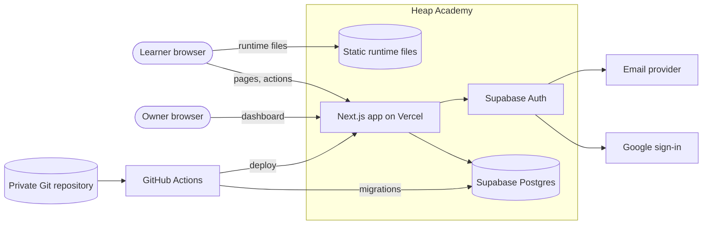
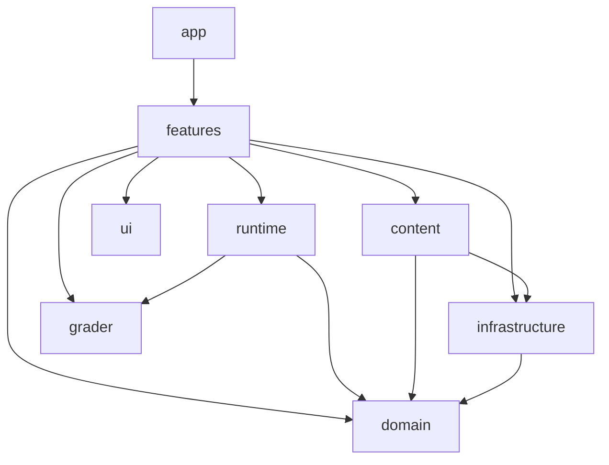
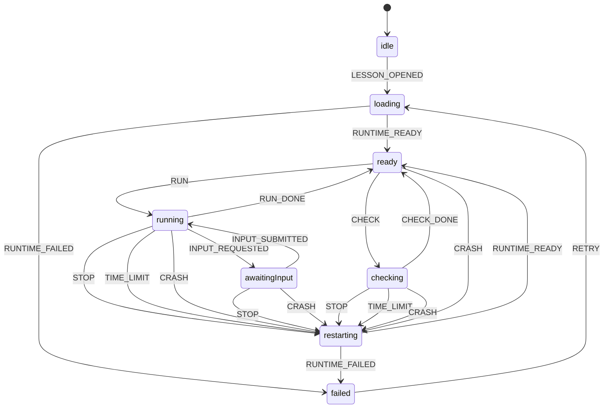
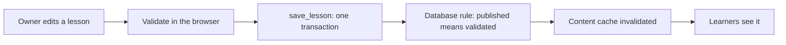
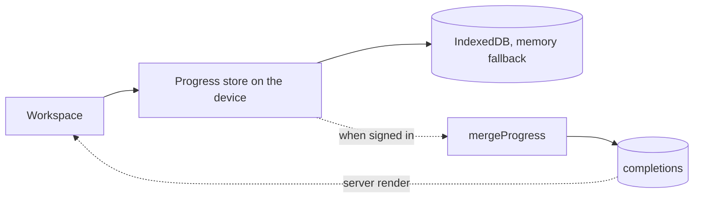

# 02 Architecture

The system for the first release. Decisions are recorded as ADRs in `docs/adr/`; this file is the map that connects them. Where a statement is backed by a prototype it says (verified) and points to `09-evidence.md`. Day 3 re-verifies each of those inside the real codebase before anything is built on top.

## 1. Drivers

Ranked. When two concerns conflict, the higher one wins.

1. **Trust in a pass.** A green Check must mean the code is right (G-2).
2. **Safety.** Learner code must never touch the app's credentials or other learners, and nobody but the owner may change a lesson (NFR-SEC-01, NFR-SEC-06).
3. **Time to first Run on a phone.** The first minute decides whether a viewer becomes a learner (G-1).
4. **No lost progress** (G-3).
5. **Near-zero marginal cost** (G-6): no server executes learner code.
6. **Eight days.** Between two sound options, take the one with fewer moving parts. Boundaries stay strict so the cut features can be added later without a rewrite.

## 2. System context



Learner code is executed only inside a browser. Nothing in the platform box ever evaluates it. Lessons live in the database, not in the repository: the owner writes them in the dashboard and no deploy is involved.

## 3. Containers

| Container | Technology | Responsibility |
|---|---|---|
| App server | Next.js App Router on Vercel | Renders pages per request, runs server actions, verifies identity, reads and writes the database under the caller's own rights. |
| App client | React, TypeScript | Course pages, workspace, dashboard. Orchestrates the runtime. Holds progress on the device. |
| Python worker | Pyodide in a module worker | Runs Python and the harness. Disposable. Used by the workspace and by dashboard validation. |
| Runtime files | Static files, immutable caching | The Pyodide distribution, versioned by path. |
| Database | Supabase Postgres | Courses, chapters, lessons, solutions, profiles, completions. Row level security on every table. |
| Identity | Supabase Auth | Google sign-in, email codes, sessions, the second sign-in step for the admin. |
| Pipeline | GitHub Actions | Verification, migrations, deploy. |

## 4. Repository structure

One private repository, one application package, pnpm (ADR-0023).

```
src/
  app/               Routes only. Thin: compose features, no business rules.
  features/          catalog, workspace, progress, auth, profile, admin
  domain/            Pure rules. No I/O, no framework imports.
  grader/            Test case schema, comparison, result types, the Python harness
  runtime/           Worker protocol, controller, watchdog, statechart, worker entry
  content/           Queries for published content (cached), the Markdown renderer
  infrastructure/    Database clients, identity verification, environment, logging
  ui/                Design tokens and primitives
  messages/          Every user-facing string
supabase/            Migrations, policy tests, seed data, config
e2e/                 Playwright journeys and accessibility checks
scripts/             Build and check scripts
docs/                Spec, ADRs, runbooks, reports, the archived plan
brand/               Brand kit supplied by the owner
```

### 4.1 Dependency rules

Enforced by lint import rules (NFR-MAINT-05). A violation fails the build.



- `domain`, `grader`, and `ui` import nothing else from the project.
- `domain` imports nothing that performs I/O: no `fetch`, no file access, no React, no Next, no Supabase, no `Date.now()` without an injected clock.
- Nothing imports from `app`. A feature imports another feature only through its `index.ts`.
- Server-only modules import `server-only`. Client code cannot import `infrastructure/db`.
- The privileged database client is created in one module, `infrastructure/db/privileged.ts`, and is imported only by the account deletion use case. A lint rule forbids every other import.

### 4.2 Inside a feature

```
features/<name>/
  components/        Client and server components
  server/            Use cases and server actions
  client/            Hooks and stores
  index.ts           The feature's public surface
```

Use cases take their dependencies as arguments (database client, clock) and are unit-tested with fakes.

## 5. Python runtime

ADR-0003, ADR-0004, ADR-0005.

### 5.1 Shape

- Pyodide runs in a **module worker**. Pyodide 314 does not support classic workers (verified, E-03).
- The distribution files come from the `pyodide` npm package pinned in the lockfile and are copied at build time to `/_runtime/pyodide/<version>/`. The lockfile hash is the integrity guarantee. Responses are `Cache-Control: public, max-age=31536000, immutable`.
- The base path is one configuration value (`RUNTIME_ASSET_BASE_URL`) so the files can later move to a zero-egress host without a code change.
- The worker is disposable. Stopping a run means terminating the worker from the page. The worker is never asked to stop itself, because a busy loop cannot read messages.

### 5.2 Protocol (version 1)

Every message is a discriminated union validated with a schema on receipt, on both sides. Unknown or malformed messages are dropped and reported.

| Direction | Message | Purpose |
|---|---|---|
| page to worker | `init { assetBase, harnessVersion }` | Load the runtime and harness. |
| worker to page | `progress { loadedBytes, totalBytes }` | Real download progress, computed against a build-time size manifest. |
| worker to page | `ready { runtimeVersion, capabilities }` | Capabilities include `interactiveInput`. |
| page to worker | `run { runId, source, mode, stdin? }` | `mode` is `interactive` or `batch`. |
| worker to page | `output { runId, stream, text }` | Batched at most every 50 ms. |
| worker to page | `input_request { runId }` | The program is waiting for a line. |
| page to worker | `input { runId, line }` or `input_end { runId }` | Answer, or end of input. |
| worker to page | `run_done { runId, outcome, truncated, durationMs }` | `outcome` is `ok` or a learner error. |
| page to worker | `check { runId, source, tests }` | Run the harness. |
| worker to page | `test_result { runId, result }` | Streamed per test case. |
| worker to page | `check_done { runId, summary }` | |
| worker to page | `fatal { reason }` | The worker cannot continue. |

Learner errors have a `kind`: `syntax`, `runtime`, `input_ended`, `output_limit`, `memory`, plus the page-side kinds `time_limit`, `stopped`, `crashed`.

### 5.3 Input strategies

Chosen by capability detection at `ready`, never by user agent (NFR-COMPAT-04).

1. **Interactive** (preferred). `input()` and `sys.stdin` reads call a JavaScript function that returns a promise; Python waits on it with Pyodide's `run_sync`, which uses WebAssembly stack switching. No shared memory and no cross-origin isolation headers are involved (verified in Chromium 153, E-05). Stack switching shipped in Chrome 137, Firefox 153, and Safari 27 (E-08).
2. **Batch** (fallback). The learner types answers into an Input field before Run, one per line. If the program reads past the end, it gets the `input_ended` error with a message that explains the field.

Checks always use batch input from the test case, so grading does not depend on the strategy.

Cross-origin isolation (and with it `SharedArrayBuffer`) is deliberately not used (ADR-0005).

### 5.4 Watchdog

- The page owns the clock. A run's budget counts only time between `run` (or `input`) and the next `input_request` or `run_done`. Waiting for the learner is free.
- On budget exceeded, Stop, or silence after `fatal`: terminate the worker, report the outcome, start a new worker. Measured cost: terminate is immediate; a new worker is ready in about 1.7 s with a warm cache (E-04).

### 5.5 Isolation between runs

Per run, inside one worker (verified, E-04, E-06):

- fresh global namespace with `__name__ == "__main__"`
- `stdin`, `stdout`, `stderr` rebound and restored
- builtins restored from a snapshot, by a routine that itself uses no builtin by name
- modules imported during the run removed from `sys.modules`
- source registered with `linecache` so tracebacks show the learner's line text

Each test case of a Check is its own run with this isolation. A full reset is a new worker. Mutating a preloaded standard library module is not undone by the soft reset; this residual risk is accepted in ADR-0004.

### 5.6 Network lock-down

The worker shares the app's origin, so code a learner was tricked into pasting could otherwise call the app with the learner's session. After the runtime has loaded everything it needs, the worker removes network and spawning APIs from its global scope and prototype chain, and its script response carries a policy with `connect-src 'self'` and no `unsafe-eval`. In the prototype, `js.fetch` was then unavailable from Python, evaluating JavaScript from Python was refused, and the standard library still imported (verified for own properties, E-07). This is hardening, not a boundary; see threat T-01 and the residual risks in `06-security-privacy.md`.

### 5.7 Loading

- Nothing about the runtime is requested until a page that needs it is open: a lesson, the home page editor, or a lesson in the dashboard.
- The lesson renders and the editor is usable while the runtime loads (NFR-PERF-03).
- A Run or Check requested while loading is remembered and starts automatically at `ready`.
- Cold download is about 5.5 MB with Brotli (measured, E-02).

## 6. Workspace lifecycle

ADR-0020. The workspace is driven by an explicit statechart in `src/runtime`, independent of React. The runtime region:



`CRASH` covers every way the worker can die without being asked to: an uncaught error, a `fatal` message, or the browser ending it under memory pressure, including while it sits idle in `ready`.

- `loading` and `restarting` carry at most one pending intent (Run or Check) that fires on `RUNTIME_READY`.
- A lesson region tracks `untouched`, `inProgress`, `passed`. `passed` is entered by `CHECK_DONE` with every test case passing and triggers a completion.
- Every transition is covered by a unit test.

The dashboard reuses the same chart for validation: it issues `CHECK` for the solution, the starter, and each wrong answer in turn.

## 7. Lessons in the database

ADR-0024, ADR-0026. Details in `04-content-system.md`.

### 7.1 Authoring



- The dashboard reads and writes through server actions that use the admin's own session. Row level security decides what the session may do (section 8.2).
- Validation runs in the admin's browser with the same worker and harness learners use. The server cannot run Python and does not try to (NFR-COST-01).
- `save_lesson` writes the lesson, its solution, and its wrong answers in one transaction, together with a flag saying whether this exact content passed validation.

### 7.2 The publish rule

A lesson may be `published` only while `validated_at >= gradable_changed_at`.

- `gradable_changed_at` is set by a trigger whenever the starter, the test cases, the solution, or the wrong answers change.
- `validated_at` is set only by `save_lesson`, and only when the dashboard reports a passing validation for the content in the same call.
- A trigger refuses any insert or update that would leave a published lesson with `validated_at` older than `gradable_changed_at`.

So a published lesson can be edited only by saving content that has just passed validation, and a draft can be saved freely. The database enforces the rule even if the interface has a bug. The claim that validation passed comes from the admin's browser; that is the trust model, recorded in ADR-0026.

### 7.3 Delivery to learners

| Material | Who can read it | How |
|---|---|---|
| Published courses, chapters, lessons (instructions, hints, starter, test cases) | Everyone | Cached queries in `src/content` using a database client with no session. |
| Solutions and wrong answers | Admin only | A separate table with an admin-only policy. No public query touches it. |
| Drafts and archived items | Admin only | Excluded by policy from every public read. |

Invariant: **public pages are built only from queries in `src/content`, and those queries use a client that carries no session.** They can return only what an anonymous visitor may read. The dashboard has its own queries under `features/admin/server`.

Instructions are stored as Markdown and rendered to elements on the server by one renderer with an allowlist (NFR-SEC-07). The dashboard preview calls the same renderer.

## 8. Data model

ADR-0012, ADR-0027. Postgres via Supabase. All timestamps are `timestamptz`. Migrations are forward-only SQL files.

| Table | Columns | Notes |
|---|---|---|
| `courses` | `id` uuid pk, `slug` unique, `title`, `summary`, `outcomes` jsonb, `position`, `status`, `created_at`, `updated_at` | `status` is `draft`, `published`, or `archived`. |
| `chapters` | `id` uuid pk, `course_id` fk, `title`, `summary`, `position` | Deleting is allowed only when empty. |
| `lessons` | `id` uuid pk, `course_id` fk, `chapter_id` fk, `slug`, `title`, `position`, `xp` (5 to 50), `instructions_md`, `hints` jsonb, `starter_code`, `tests` jsonb, `status`, `gradable_changed_at`, `validated_at`, `published_at`, `created_at`, `updated_at` | `slug` is unique inside a course. The chapter must belong to the course. Size checks on every text column. |
| `lesson_solutions` | `lesson_id` pk fk (cascade), `solution_code`, `wrong_answers` jsonb, `updated_at` | Admin only. |
| `admins` | `user_id` pk fk to auth users (cascade), `created_at` | The allow-list. Rows are added by SQL, never by the app. No client policy at all. |
| `profiles` | `user_id` pk fk to auth users (cascade), `display_name` (1 to 40 chars), `time_zone`, `created_at`, `updated_at` | Created by a trigger when a user is created. |
| `completions` | `user_id` fk (cascade), `lesson_id` fk (restrict), `completed_at`, `xp`, `code` (at most 20,000 chars) | Primary key (`user_id`, `lesson_id`). Insert only. `xp` is copied from the lesson by a trigger. |

### 8.1 Derived values

- **XP** is `sum(completions.xp)` for a learner. `xp` on a completion is set by the database from the lesson at the moment of completion and is never accepted from a client (FR-PRG-04). Totals are never stored (ADR-0012).
- **Streak** is computed by a pure function in `src/domain` from the learner's completion times and time zone. The same function serves guests and accounts.

### 8.2 Row level security

Enabled on every table. Default deny. Every policy has a test.

| Table | Anonymous | Signed-in learner | Admin with the second step |
|---|---|---|---|
| `courses` | Select published | Select published | All |
| `chapters` | Select where the course is published | Same | All |
| `lessons` | Select where the lesson and its course are published | Same | All |
| `lesson_solutions` | Nothing | Nothing | All |
| `admins` | Nothing | Nothing | Nothing |
| `profiles` | Nothing | Select and update own row | Own row |
| `completions` | Nothing | Select own rows; insert own row for a published lesson | Own rows, plus counts through a function |

"Admin" in a policy means `private.is_admin()`: the caller is in `admins` **and** the session token carries assurance level `aal2`, which Supabase sets only after the second sign-in step (E-20). An admin who has not passed the second step is an ordinary learner to the database.

### 8.3 Functions and triggers

| Object | Purpose |
|---|---|
| `private.is_admin()` | Security definer, fixed search path, in a schema the API does not expose. Used by policies. |
| `public.save_lesson(...)` | Security invoker, so policies apply. Writes lesson, solution, and wrong answers in one transaction and sets `validated_at` when told the content passed. Refuses when the row is newer than the editor's copy (FR-ADM-10). |
| Trigger: gradable change | Sets `gradable_changed_at` when starter, test cases, solution, or wrong answers change. |
| Trigger: publish guard | Enforces section 7.2. Also refuses publishing a course with no published lesson. |
| Trigger: completion values | Copies `xp` from the lesson, and clamps `completed_at` so it is never in the future. |
| Trigger: new user | Creates the `profiles` row. |
| `public.lesson_completion_counts()` | Security definer, admin only inside the function. Returns counts per lesson for the dashboard (FR-ADM-13). |

Every function with elevated rights pins its search path and is reviewed by `security-reviewer`.

## 9. Server boundary

ADR-0027. The browser never talks to the database. It talks to the app server, which acts with the caller's own session so that row level security is the authority for every read and write.

### 9.1 Server actions

Every mutation is a server action built with one wrapper. The wrapper provides, in order: a request ID, identity from verified claims, schema parsing with size limits, the call to the use case, a typed result, and a structured log line. Nobody hand-rolls any of these.

| Action | Purpose | Caller |
|---|---|---|
| `requestEmailCode`, `verifyEmailCode`, `signOut` | Sign-in with an email code | Anyone |
| `recordCompletion` | Store a completion (idempotent) | Signed in |
| `mergeProgress` | Merge completions from the device (idempotent) | Signed in |
| `updateProfile` | Display name, time zone | Signed in |
| `deleteAccount` | Delete the account | Signed in, recent sign-in |
| `saveCourse`, `setCourseStatus`, `saveChapter`, `deleteChapter`, `reorder` | Course structure | Admin |
| `createLesson`, `saveLesson`, `setLessonStatus`, `deleteLesson` | Lessons | Admin |
| `renderInstructionsPreview` | Markdown to elements, same renderer as learners see | Admin |
| `exportCourse`, `importLesson` | JSON out and in (FR-ADM-12) | Admin |

Rules:

- A server action is a public endpoint. It trusts nothing it receives: no user ID, no role, no XP, no status it has not checked.
- Identity comes from `getClaims()`, never from an unverified session read (E-09).
- Reads and writes use the session-scoped database client. The wrapper refuses an admin action unless `is_admin` is true for the session, and the database refuses it again.
- After a change to published content, the action invalidates the content cache (section 12).
- `deleteAccount` is the only code path that uses the privileged client.

### 9.2 Route handlers

| Method and path | Purpose |
|---|---|
| `GET /api/health` | Liveness, and whether the database answers |
| `POST /api/csp-report` | Receives content security policy reports. Size-capped. |
| `POST /api/client-error` | Receives client error reports with no personal data. Size-capped. |
| `GET /auth/callback` | Completes Google sign-in |

## 10. Progress and sync

ADR-0011. One mechanism for guests and accounts.



- **On the device**: completions and saved code live in IndexedDB. If storage is unavailable, an in-memory store is used and the learner is told progress will not survive closing the tab.
- **A pass** is written to the device first and shown at once. For a signed-in learner the store then calls `recordCompletion`; on failure the entry stays marked unsynced.
- **Sync**: on sign-in, on page load while signed in, and when the tab becomes visible, the store sends every unsynced completion through `mergeProgress`. The server inserts each with "do nothing on conflict" and returns the account's full list. The store marks entries synced only after a success.
- **Merge** is a pure function in `src/domain`, property-tested for idempotence and commutativity.
- For a signed-in learner, pages are rendered with their progress on the server. For a guest, progress is filled in on the client from the store.

What the server enforces on a completion: verified identity, a published lesson, one row per learner and lesson, XP from the lesson. What it does not enforce: that the code was correct. See the trust model in ADR-0007.

## 11. Authentication

ADR-0017, ADR-0025.

### 11.1 Learners

- **Google**: redirect flow with PKCE through Supabase Auth to `/auth/callback`, which exchanges the code, sets session cookies, and redirects to a validated return path.
- **Email code**: the learner submits an email with a bot challenge token; Supabase sends a six-digit code; the learner types it; the session is created in the same tab. The email template shows the code, not a link.
- **Session refresh**: handled in `proxy.ts`, following Supabase's server-side guide (E-09). The proxy does no network work for a request without a session cookie, and it fails open: if the auth service cannot be reached, the page is still served and the visitor is treated as signed out.
- **In-app browsers**: Google refuses sign-in inside embedded webviews (E-10). The sign-in view detects known in-app browser user agents, leads with the email code, and explains why. A manual link shows the Google option anyway.
- **Return path**: accepted only if it is a relative path that starts with a single `/`. Everything else falls back to `/courses`.

### 11.2 The admin gate

- Being an admin is a row in `admins`. The owner adds his own row once, by SQL, following a runbook. No screen grants admin rights.
- The second step is an authenticator app (TOTP) through Supabase's multi-factor API (E-20). Enrollment happens at `/admin/setup`; later sessions are challenged at `/admin/verify`.
- Every `/admin` layout calls one server guard. A visitor who is not on the list gets the standard not-found response. An admin with no factor is sent to setup; an admin at `aal1` is sent to verify.
- The guard is a convenience. The authority is the database: every admin policy requires `private.is_admin()`, which requires `aal2`.

## 12. Rendering, caching, and the script policy

ADR-0028.

- **Every page is rendered per request.** A per-request nonce is the script policy the framework documents and supports, and it requires dynamic rendering; a static page under a nonce policy has its scripts blocked (E-21). One policy for every route is simpler to build and to test than a policy per route class.
- `proxy.ts` creates the nonce and sets the policy header (`06-security-privacy.md` section 5.2). `'wasm-unsafe-eval'` belongs to the worker script's own policy, not the page's.
- **Content is cached as data.** Queries in `src/content` are wrapped in the framework's data cache and tagged. Admin actions that change published content invalidate the tag, so a change is visible within a minute (FR-ADM-11) and most page views cost no database query.
- The first release does not enable the framework's Cache Components mode: it prerenders a static shell, which cannot carry a nonce (E-21).
- Cost of this choice: every page view runs a function. At launch scale that is small (`07-operations.md` section 9). ADR-0028 names the trigger for moving public pages to static rendering.

## 13. Cross-cutting concerns

| Concern | Rule |
|---|---|
| Configuration | All environment variables are declared in one schema and validated at build and at start. A missing or malformed value stops the process with the variable's name. `.env.example` lists every variable. |
| Errors | Programmer errors throw. Expected failures at boundaries (validation, not found, denied, conflict) are typed results. No silent catch. |
| Logging | Structured JSON on the server with request ID, action or route, outcome, duration. No personal data. |
| Telemetry | `ErrorReporter` and `Analytics` ports with console and host adapters (ADR-0019). Product code calls the ports only. |
| Readiness for Arabic | Strings in `src/messages`. Logical CSS properties only. Language and direction from one configuration value (ADR-0016). |
| Time | A clock is injected. A local day is derived with the platform's time zone formatting for an IANA zone; no manual offset arithmetic. |
| IDs | Database row IDs are UUIDs generated by the database. Types are branded (`LessonId`, `CourseId`, `UserId`) so they cannot be mixed. |

## 14. Pitfalls already found

Each of these cost time in the prototypes or in reading current documentation. Each has a test in the plan.

1. Pyodide 314 loads only in module workers; its loader files are `.mjs`.
2. A JavaScript `null` arrives in Python as `JsNull`, not `None`. `undefined` arrives as `None`. Use typed messages and never rely on `null` (verified, E-05).
3. Restoring builtins after learner code must not call any builtin by name, because the learner may have deleted it (found in the prototype, E-06).
4. Time waiting for the learner's input must not count against the time limit.
5. When input ends early Python raises `EOFError`; map it to a learner message.
6. The Pyodide core needs `'wasm-unsafe-eval'` in the policy and does not need `'unsafe-eval'` (verified in Chromium, E-07).
7. A worker loaded from a URL takes its content security policy from its own response headers, not from the page that started it. Set the policy on worker script responses and prove it from inside the worker.
8. Google sign-in fails inside TikTok and Instagram in-app browsers (E-10).
9. Supabase's built-in email sender is limited to 2 emails per hour (E-11).
10. A per-request nonce needs dynamic rendering. Partial prerendering and static generation are incompatible with it (E-21).
11. In development the framework needs `'unsafe-eval'` for debugging; production must not have it (E-21).
12. The editor library injects style elements at run time. It must be given the nonce, or its styles are blocked. First check in WP-5.2.
13. The assurance level lives in the session token. After the second step the token must be refreshed before the server sees `aal2` (E-20).
14. A server action is reachable by anyone who can craft a request. Treat it like any public endpoint.

## 15. ADR index

| ADR | Decision | State |
|---|---|---|
| 0001 | Monorepo with pnpm workspaces and Turborepo | Superseded by 0023 |
| 0002 | Next.js App Router on Vercel | Proposed |
| 0003 | Learner code executes only in the browser | Proposed |
| 0004 | Python runtime: Pyodide in a module worker, self-hosted | Proposed |
| 0005 | Interactive input by stack switching with a batch fallback | Proposed |
| 0006 | Web previews in a dedicated sandbox document | Deferred by 0022 |
| 0007 | Trust model for client-side grading | Proposed |
| 0008 | Content as files with stable IDs and a synced catalog | Superseded by 0024 |
| 0009 | Supabase; server-mediated writes; deny by default | Superseded by 0027 |
| 0010 | Explicit versioned HTTP API for mutations | Superseded by 0027 |
| 0011 | Guest-first progress with merge on sign-in | Proposed |
| 0012 | Derive XP and streak; store no aggregates | Proposed |
| 0013 | CodeMirror 6 as the editor | Proposed |
| 0014 | UI foundation: tokens, Tailwind CSS, React Aria Components | Proposed |
| 0015 | Dark theme only, behind a theme contract | Proposed |
| 0016 | English only, with enforced right-to-left readiness | Proposed, reduced by 0022 |
| 0017 | Sign-in with Google and email one-time code | Proposed |
| 0018 | Access tiers as a policy seam, open at launch | Deferred by 0022 |
| 0019 | Observability through ports | Proposed, reduced by 0022 |
| 0020 | Workspace lifecycle as a statechart | Proposed |
| 0021 | Content security policy by route class | Superseded by 0028 |
| 0022 | An eight-day first release: what ships and what waits | Proposed |
| 0023 | One application package with enforced module boundaries | Proposed |
| 0024 | Lessons live in the database and are written in an admin dashboard | Proposed |
| 0025 | Admin access: allow-list, second sign-in step, enforced by the database | Proposed |
| 0026 | One test case model, validated in the admin's browser before publishing | Proposed |
| 0027 | Server actions behind one wrapper; row level security is the authority | Proposed |
| 0028 | One nonce-based script policy; pages render per request | Proposed |
