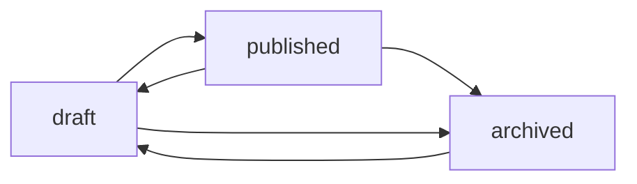

# 04 Lessons and Grading

How lessons and test cases are modeled, validated, and published. Lessons are the product. The code exists to deliver them and to make a pass trustworthy.

Lessons live in the database and are written by the owner in the admin dashboard (ADR-0024). Nothing in this document is a file in the repository.

## 1. The model

One schema in `src/grader` and `src/domain` defines these shapes. The dashboard forms, the server actions, the database checks, and import all use it, so a limit is written once.

### 1.1 Course

| Field | Rule |
|---|---|
| `title` | 1 to 60 characters. |
| `slug` | The address segment. Lowercase letters, digits, hyphens. Unique. |
| `summary` | One sentence, at most 140 characters. |
| `outcomes` | Optional. Up to five things the learner will be able to do. Each starts with a verb. |
| `status` | `draft`, `published`, or `archived`. A course needs one published lesson to be published. |

### 1.2 Chapter

`title` (1 to 60 characters), `summary` (optional, one sentence), and its position in the course.

### 1.3 Lesson

| Field | Rule |
|---|---|
| `title` | 1 to 60 characters. |
| `slug` | Unique inside the course. |
| `xp` | Integer from 5 to 50. Default 10. |
| `instructions_md` | Markdown (section 5). 1 to 20,000 characters. |
| `hints` | Up to five, each at most 300 characters. The workspace reveals one at a time. |
| `starter_code` | What the learner sees first. At most 10,000 characters. May be empty. |
| `solution_code` | The owner's correct answer. At most 10,000 characters. Admin only. |
| `wrong_answers` | Up to three, each a label (what the mistake is) and code. Admin only. |
| `tests` | 1 to 12 test cases (section 2). |
| `status` | `draft`, `published`, or `archived`. |

A lesson is one Python file. Its ID is a UUID that never changes, so renaming a lesson or changing its address never detaches a learner's completion.

## 2. Test cases

One model covers every lesson (ADR-0026).

### 2.1 Fields

| Field | Rule |
|---|---|
| `id` | Generated. Stable inside the lesson. |
| `name` | What the learner reads, written as a requirement: "Prints the total on one line". 1 to 80 characters. |
| `stdin` | What the program is given as input, one answer per line. May be empty. At most 2,000 characters. |
| `after_code` | Optional Python that runs after the learner's program, in the same namespace. At most 2,000 characters. |
| `expected` | The output the program must print. At most 5,000 characters. |
| `match` | `normalized` (default), `exact`, or `contains`. |
| `hint` | Optional. Shown when this test case fails. Says what to look at, never the answer. At most 200 characters. |

Every test case is visible to the learner, including its follow-up code. Because grading runs in the browser, nothing about a test case could be kept secret anyway (ADR-0007).

### 2.2 How a test case runs

1. A fresh namespace and restored builtins (`02-architecture.md` section 5.5).
2. Standard input is the test case's `stdin`.
3. The learner's program runs.
4. If it finished without an error, `after_code` runs in the same namespace.
5. Everything written to standard output by both steps is the actual output. Standard error is not compared.
6. The actual output is compared with `expected` under the `match` mode.

A test case fails when the comparison fails, when the learner's program raises an error, when it reaches the 5 second limit, or when the follow-up code raises an error. The last case is reported in learner language: follow-up code that fails with a missing name means "This test needs something named `area`."

A prompt passed to `input()` is part of the output. The typed answer is not echoed, and no line break follows the prompt. So a program that asks "What is your name? " and then prints a greeting produces one line: `What is your name? Hello, Sara!`. The dashboard's "Fill from solution" action captures this exactly, which is why it exists.

### 2.3 Comparison

| Mode | Rule |
|---|---|
| `normalized` (default) | Line endings unified; trailing whitespace removed from each line; trailing blank lines removed. Leading whitespace and letter case are significant. |
| `exact` | Character for character. |
| `contains` | The expected text appears in the output after normalization. |

When FR-GRD-07 is built, a failed comparison is classified so the message can be specific: differs only in letter case, only in spaces, only in punctuation, or by a missing last line. Beginners cannot see these differences; the product names them.

### 2.4 Three patterns

**Input and output.** The program reads and prints. Use at least two test cases with different inputs, so that printing a fixed answer fails.

| name | stdin | expected |
|---|---|---|
| Greets Sara by name | `Sara` | `What is your name? Hello, Sara!` |
| Works for a different name | `Omar` | `What is your name? Hello, Omar!` |

**A variable.** The lesson asks for a variable. Follow-up code prints it.

| name | after_code | expected |
|---|---|---|
| `age` is a whole number | `print(type(age).__name__)` | `int` |

**A function.** The lesson asks for a function. Follow-up code calls it.

| name | after_code | expected |
|---|---|---|
| `area(3, 4)` gives 12 | `print(area(3, 4))` | `12` |
| `area(5, 5)` gives 25 | `print(area(5, 5))` | `25` |

## 3. The harness

### 3.1 Python harness

- Lives in `src/grader`. Pure Python, standard library only. The same file runs in Pyodide under Node in the test suite and in Pyodide in browsers. The prototype ran one harness file unchanged on CPython and inside Pyodide (E-06).
- Implements section 2.2 and the isolation in `02-architecture.md` section 5.5.
- Returns structured results only. It never raises to the caller.
- Versioned. The version is included in every result.
- It is trusted code that runs next to untrusted code, so it is small, dependency-free, and heavily tested.

### 3.2 Running it outside a browser

`src/grader` also has a small runner that executes the harness in Pyodide inside a Node worker thread, with the same time limit behavior as the browser (terminate on limit). The grader's own tests and the parity suite use it (FR-GRD-04). Prototype timings: start about 1.8 s, three tests in about 2 ms, a runaway loop terminated at its limit (E-04).

It is a test tool. No production path runs learner or lesson code on a server.

## 4. Validation and publishing

### 4.1 The rules

A lesson passes validation when all of these hold for the content in the editor:

1. It has a title, an address, instructions, and at least one test case.
2. The solution passes every test case.
3. The starter fails at least one test case. Otherwise the lesson is already solved when it opens.
4. Every recorded wrong answer fails at least one test case.
5. No run reached the time limit.

### 4.2 Where each rule is enforced

| Layer | What it does |
|---|---|
| Dashboard | Runs the rules in the admin's browser with the real runtime and harness. Shows the reason for each failure. Offers Publish only after a pass. |
| Server action | Parses the lesson with the schema of section 1. Recomputes a hash of the gradable content (starter, solution, wrong answers, test cases) and reports validation as passed only when it equals the hash the dashboard validated. Passes the content and the result to the database in one call. |
| Database | A published lesson must have been validated since its last change to starter, solution, wrong answers, or test cases (`02-architecture.md` section 7.2). |

The server does not re-run Python, so the database trusts the admin's browser to report validation truthfully. That is acceptable because the only admin is the owner and the purpose is to catch mistakes, not attacks (ADR-0026).

### 4.3 States



- **Draft**: visible only in the dashboard. Saved freely, valid or not.
- **Published**: visible to everyone. Counted in course totals.
- **Archived**: gone from the site. Completions and their XP remain. A lesson with completions can be archived but not deleted.

### 4.4 Editing a published lesson

- Changing the title, instructions, hints, or XP saves at once. XP already earned does not change.
- Changing the starter, solution, wrong answers, or test cases requires a passing validation in the same save. The lesson is never live in a half-edited state.
- If a change could fail code that used to pass, earlier completions still stand. They are a record of what the learner passed at the time.

## 5. Markdown

Instructions are plain Markdown.

- Allowed: paragraphs, emphasis, inline code, fenced code blocks with a language, lists, tables, headings of level two and three, block quotes, `https` links.
- Not allowed: raw HTML, images, scripts, any other link scheme. The renderer drops them.
- One renderer on the server turns Markdown into elements through an allowlist. It is used by the workspace and by the dashboard preview, so the preview cannot differ from the real page. No raw HTML string is ever injected into a page (NFR-SEC-07).
- Fenced code blocks are highlighted on the server and have a copy control.
- Links open in a new tab with `rel="noopener noreferrer"`.

## 6. Writing a good lesson

This section is for the owner. The dashboard shows the short form of these rules as field help.

### 6.1 Teaching

- One new idea per lesson. Explain it in at most 150 words before the first code sample.
- Show runnable code before asking for any.
- The task makes a small real thing.
- Hints go from a nudge, to the construct, to the outline. Never the answer.

### 6.2 Writing

- Short sentences for a reader with English as a second language. Define each term once and keep using it. No idioms.
- Output shown in a lesson is the real output of the code shown. Run it.
- Examples suit young learners in the Gulf: no gambling, alcohol, or dating themes; no real brands or public figures.
- Python style: PEP 8, four spaces, double quotes.

### 6.3 Test cases

- Test case names read as the task's requirements. A learner should be able to do the task from the names alone.
- When the program reads input, use at least two test cases with different inputs.
- Record the answer a learner is most likely to get wrong (often: printing the example's output directly) as a wrong answer. Validation then proves the test cases catch it.
- Use "Fill from solution" for expected output, then read what it filled in. If the solution is wrong, the expected output is wrong too.

## 7. A complete example

**Title**: Say hello by name. **XP**: 10.

**Instructions**

```markdown
## Ask, then answer

`input()` waits for the person to type something, and gives you what they typed.

    name = input("What is your name? ")
    print("Hello, " + name + "!")

## Your task

Ask for a name. Then print a greeting that uses it.
```

**Starter**

```python
# Ask for a name, then greet that person.
```

**Solution**

```python
name = input("What is your name? ")
print("Hello, " + name + "!")
```

**Wrong answer** (label: prints a fixed name)

```python
input("What is your name? ")
print("Hello, Sara!")
```

**Test cases**: the two in the first table of section 2.4.

Validation: the solution passes both; the starter prints nothing and fails both; the wrong answer passes the first and fails the second. With only the first test case, the wrong answer would have been accepted. The prototype showed the same effect on a lesson of this shape (E-06).

## 8. Export and import

Built in WP-6.4 when the plan is on schedule (FR-ADM-12).

A lesson exports to one JSON object:

```json
{
  "format": "heap-academy.lesson",
  "version": 1,
  "title": "Say hello by name",
  "slug": "say-hello-by-name",
  "xp": 10,
  "instructions_md": "...",
  "hints": ["..."],
  "starter_code": "...",
  "solution_code": "...",
  "wrong_answers": [{ "label": "prints a fixed name", "code": "..." }],
  "tests": [
    { "name": "Greets Sara by name", "stdin": "Sara\n", "after_code": "", "expected": "What is your name? Hello, Sara!", "match": "normalized", "hint": "" }
  ]
}
```

A course export wraps the course fields and a list of chapters, each with its lessons in this shape. Import accepts one lesson, parses it with the schema of section 1, and creates a draft. An imported lesson is published the same way as any other: through validation.

## 9. A starting outline for Python

A suggestion for the owner, not a requirement. It is the outline from the archived plan.

| Chapter | Ideas |
|---|---|
| 1 Say something | `print`, strings, comments |
| 2 Remember things | variables, numbers, types |
| 3 Ask and calculate | `input`, arithmetic, f-strings |
| 4 Decide | booleans, `if`, `elif`, `else` |
| 5 Repeat | `while`, `for`, `range`, `break` |
| 6 Collect | lists |
| 7 Reuse | functions, `return` |

Three to five lessons per chapter is enough to launch a chapter. A course can be published with its first chapter and grow.
