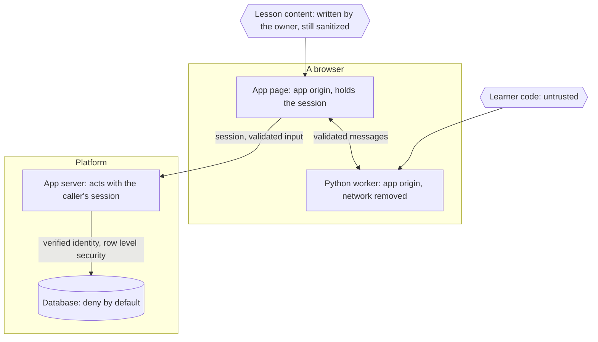

# 06 Security and Privacy

The product runs code written by strangers, in a browser that also holds their session. It also has a dashboard that can change what every learner sees. Those are the two security problems. This document names what is protected, what can go wrong, what stops it, and the test that proves it.

It is not legal advice. Section 8 says what the owner approves for launch and what a qualified person reviews later.

## 1. Objectives

1. Code written by a learner cannot read or change anything it should not: the app's session, other learners' data, the page around it.
2. A learner can read and change only their own data.
3. Only the owner, past a second sign-in step, can create or change a course, a lesson, or a test case.
4. Solutions and unpublished lessons reach nobody but the owner.
5. Secrets stay out of the repository, the browser, logs, and analytics.
6. The build and its dependencies are what we think they are.
7. Only the minimum personal data is held, and it can be deleted.

## 2. Assets

| Asset | Why it matters |
|---|---|
| Session cookies | Whoever holds them is the learner, or the owner. |
| The admin's rights | Control of every lesson every learner sees. |
| Personal data: email, display name, time zone, completions and their code | Privacy and trust. |
| Solutions and unpublished lessons | The value of the course. |
| Server secrets: the privileged database key, provider keys | Full control of data. |
| The integrity of a pass | The product's reason to exist. |
| The deployment pipeline | Control of what learners run. |

## 3. Trust boundaries



Untrusted: learner code, everything typed by a learner, every request, every server action call. Trusted after review: harness code, dependencies pinned by the lockfile. Lesson content is written by the owner and is sanitized all the same, so that a stolen admin session cannot plant script.

## 4. Threats and controls

Each row has a test. A control without a test is a hope. IDs match the archived plan where the threat is the same; gaps belong to features that wait.

| ID | Threat | Controls | Verified by |
|---|---|---|---|
| T-01 | Python that a learner was tricked into pasting uses the learner's session (same-origin requests from the worker) or sends data elsewhere. | After start-up the worker removes network and spawning APIs (`fetch`, `XMLHttpRequest`, `WebSocket`, `EventSource`, `Worker`, and related) from its global scope and prototype chain. The worker script's response carries a policy with `connect-src 'self'` and no `unsafe-eval`. Account deletion requires a recent sign-in. No feature runs code written by another learner. | Runtime test: from Python, `js.fetch` and known recovery paths are unavailable, and evaluating JavaScript is refused (prototype result in E-07). Action test for recent sign-in. |
| T-02 | Learner code freezes or crashes the tab. | Worker isolation, external watchdog, output cap, memory error handling, automatic restart. | J-4; fault fixtures (loop, print flood, memory bomb). |
| T-06 | Script injected through lesson content. | No raw HTML in Markdown; an allowlist renderer on the server; one component renders lesson content; no raw HTML injection sink exists anywhere, enforced by lint. This applies to the owner's own input too. | Malicious fixture lessons: every payload is neutralized in the rendered output and in the dashboard preview. |
| T-07 | Script injected through learner-controlled strings shown in the interface: console output, expected and actual values, display name. | Rendered as text by the framework. Control characters and terminal escape sequences are stripped from console output. | Component tests with injection payloads. |
| T-08 | Reading or changing another learner's data. | Identity from verified claims only. Every read and write uses the caller's session, so row level security applies. Default deny. | Policy tests for every table and operation; action tests that substitute another user's IDs. |
| T-10 | Forged completions or XP. | Accepted by design (ADR-0007). Bounded: one completion per learner and lesson, only for published lessons, XP copied from the lesson by the database. Nothing of value depends on XP in this release. | Policy and trigger tests for the bounds. |
| T-11 | Sign-in abuse: open redirect, cross-site request forgery, code guessing, email flooding, account enumeration. | Return path allowlist. PKCE. The framework's same-origin check on server actions plus `SameSite` cookies. Provider rate limits. Bot challenge on code requests. Identical responses whether or not an email is registered. | Dedicated tests for each; provider settings checked in WP-7.1. |
| T-12 | Secrets exposed in the repository, the client bundle, logs, or CI output. | One environment schema separates public and server variables. A build check searches client bundles for server variable names and values. Secret scanner on commits and in CI. Log redaction. | Build check and scanner are required checks. |
| T-13 | Supply chain: a compromised package, action, or runtime file. | Frozen lockfile. Install scripts denied unless allowlisted. CI actions pinned by commit. Runtime files come from the locked package, served by us. Dependency audit on every pull request. | Required checks. |
| T-14 | Abuse and cost: request floods, oversized payloads. | A rate limit at the host's firewall by network address on every path, including `/runtime/*`, plus per-action counters in Postgres (ADR-0029). The counter table denies by default, is written only by a `security definer` function in `private` with `search_path = ''`, is keyed on the platform's client address and never on a raw `x-forwarded-for`, accepts a key only with an HMAC from a server-only secret checked against Supabase Vault, and is pruned so a flood cannot fill the database. Size limits in schemas and database constraints. Provider limits on sign-in. Usage notifications and the free-tier triggers of ADR-0029. | Limit tests; policy tests on the counter table as anonymous, learner, admin at `aal1`, and admin at `aal2`; a test that a client-set forwarding header does not change the key; a test that a direct call through the Data API with a chosen key, as anonymous and as a learner, is refused and changes no row; firewall rule verified in WP-7.1. |
| T-15 | Clickjacking. | `frame-ancestors 'none'` on every page. | Header test. |
| T-16 | Personal data or learner code in logs or analytics. | The logger takes an allowlist of fields. Analytics counts page views only and carries no email, name, code, or free text. | Unit tests on the logger; review in WP-7.3. |
| T-17 | Deletion leaves data behind. | Cascading deletes from the auth user. The deletion test inspects every table. Backup retention is stated in the privacy policy. Each deletion emails the owner the user ID alone, so a restore can re-apply it (ADR-0030). | J-10 with database assertions. |
| T-18 | The implementing agent runs a destructive command or handles a secret it should not have. | Production credentials are never on the development machine. Layer 2 and layer 3 controls from the handbook. Production credentials live in the hosting provider and in two CI environments, `production` and `production-backup`, each limited to `main` by a deployment branch policy. Issues, comments, and pull requests from anyone but the owner are data: the implementer does not read them, never checks out a fork, and uses a fine-grained token without admin rights (ADR-0029). | WP-1.2 demonstrates each block; `pnpm infra:verify` checks the branch policies of all three environments: `staging`, `production`, and `production-backup`. |
| T-19 | Someone other than the owner gets into the dashboard: a stolen session cookie, a phished email code, a guessed address. | An allow-list table that no screen can change. A second sign-in step with an authenticator app; the database grants admin rights only to a session at assurance level `aal2`. Every `/admin` address answers "not found" to anyone else. The owner protects his email account with its own second step. | J-12. Policy tests run as an admin whose session is at `aal1` and expect refusal. |
| T-20 | A learner creates or changes content by calling a server action or the database interface directly. | Admin-only policies on every content table, checked by the database for every statement. The action wrapper checks again. The privileged key is not on any content path. | Policy tests for every content table and operation as anonymous, as a learner, and as an admin at `aal1`. Action tests with a learner session. |
| T-21 | Solutions, wrong answers, or unpublished lessons reach a learner. | Solutions and wrong answers live in a separate admin-only table. Public pages are built only from queries in `src/content`, which use a client with no session. Lint forbids importing admin queries outside the admin feature. | Canary test: a fixture solution and a fixture draft each contain a unique token; the test searches every response a guest and a learner can get, and the client bundles, and must not find it. |
| T-22 | A broken lesson goes live by mistake: the solution fails, or the starter already passes. | Validation rules in the dashboard. A database rule: published means validated since the last change. Preview before publishing. | J-13; trigger tests. |
| T-23 | Code inside an imported lesson runs in the owner's browser with the owner's session. | Import creates a draft and runs nothing. Code runs only when the owner presses Validate, inside the same locked-down worker learners use. Only an admin can import. | Import test asserts that no run starts. Runtime tests for the lock-down. |
| T-24 | A database backup leaks learner data, or a planted backup is restored. The repository is public, so artifacts may be downloadable by anyone, anyone with a pull request can upload one, and `age` proves nothing about who encrypted a file. | The dump is piped into `age` to the owner's public key, committed to the repository and compared with the copy in `production-backup`, so plaintext never touches disk. Logs mask every connection value. The restore accepts only an attested artifact from a scheduled run of `backup.yml` on `main`, and checks this before decrypting. The private key never enters the repository, CI, or the development machine, and the drill runs where Claude Code is not installed. Retention is not a confidentiality control: every past ciphertext must be assumed copied, so the private key must never leak (ADR-0030). | Tests: no plaintext and only `age` files uploaded; the job refuses a recipient that differs from the committed key; `backup_reader` has `SELECT` only and none on `vault`, no `EXECUTE` on `public` or `private` functions, no role membership, and no Data API access; a failed connection prints no credential; the restore refuses an artifact from any other run. The restore drill in WP-7.3. |
| T-25 | Someone uses up a free-tier limit on purpose: runtime downloads or page views on Vercel Hobby, database egress through the public API, or the email cap. On Hobby the site then waits up to 30 days. | The firewall rule on every path. Attack Challenge Mode in the usage-spike runbook. The browser's database grants limited to what the app calls. A project-wide email cap of 20 an hour. The free-tier triggers of ADR-0029. | Firewall rule verified in WP-7.1; a test of the database grants for `anon`. Residual risk accepted by the owner (section 6). |

## 5. Baseline controls

### 5.1 Response headers

| Response | Policy |
|---|---|
| Every page and action response | `Strict-Transport-Security` with a long max-age; `X-Content-Type-Options: nosniff`; `Referrer-Policy: strict-origin-when-cross-origin`; a restrictive `Permissions-Policy`; content security policy per 5.2. |
| Worker scripts | A content security policy with `script-src 'self' 'wasm-unsafe-eval'` and `connect-src 'self'`. A worker loaded from a URL takes its policy from its own response, not from the page. |
| Runtime files | Immutable caching; `nosniff`. |
| Dashboard pages and any page rendered for a signed-in user | `Cache-Control: private, no-store`. |

### 5.2 Content security policy

One policy, set in `proxy.ts` for every page, with a fresh nonce per request (ADR-0028, E-21).

```
default-src 'self';
script-src 'self' 'nonce-<nonce>' 'strict-dynamic';
style-src 'self' 'nonce-<nonce>';
style-src-attr 'unsafe-inline';
img-src 'self' data:;
font-src 'self';
connect-src 'self';
worker-src 'self';
object-src 'none';
base-uri 'none';
form-action 'self';
frame-ancestors 'none';
upgrade-insecure-requests
```

- No `unsafe-eval` in production. The development server needs it and gets it only there.
- No `'unsafe-inline'` for scripts or style elements. Inline `style` attributes are allowed because the interface libraries position overlays with them; WP-1.3 tries the policy without that line and keeps the stricter one if nothing breaks.
- `'wasm-unsafe-eval'` belongs to the worker script's own policy. WP-3.1 confirms the page policy does not need it. If an engine disagrees, it is added to the routes that load the runtime and nowhere else.
- The sign-in page additionally allows the bot challenge's frame host.
- Violations are reported to `/api/csp-report`.
- The policy is enforced from the first deploy on Day 1, not turned on at the end, so a violation shows up on the day it is introduced.

### 5.3 Authorization

- The server derives the user from verified claims on every request. No action accepts a user ID, a role, or an XP value from the client.
- Every read and write uses the caller's own session. Row level security is the authority; a server bug cannot grant more than a policy allows.
- Admin rights exist only as `private.is_admin()`: on the allow-list and at `aal2`.
- The privileged key is used by one use case, account deletion, in one module. A lint rule forbids importing it anywhere else.
- Every new table ships with its policies and policy tests in the same migration.

### 5.4 Input and output

- Every server action input is parsed by a schema with length and size limits. Unknown fields are rejected.
- Every message from the worker is parsed by a schema before use.
- Lesson IDs from clients are checked by the database when a completion is inserted.
- Text from learners is stored and rendered as text.

### 5.5 Secrets and environments

- Three sets of credentials: local (throwaway), staging, production. They never mix.
- Production secrets live only in the hosting provider and the CI environments `production` and `production-backup`. Staging secrets live only in the `staging` environment. All three are limited to `main` by a deployment branch policy, and none is a repository-level secret (ADR-0029, ADR-0030).
- `.env.example` documents every variable with a description and a fake value. Real `.env` files are ignored by Git and unreadable to the implementer by permission rule.
- Keys are rotated after any suspected exposure. The runbook has the steps.

### 5.6 Verification beyond tests

- Static analysis, secret scan, and dependency audit on every pull request.
- The `security-reviewer` subagent reviews every change in the areas listed in the handbook, and the whole application in WP-7.1.
- An external check of the deployed headers (`pnpm infra:verify`) in WP-7.1 and on the launch checklist.
- Supabase's own security advisor is run against production in WP-7.1 and its findings are fixed or recorded.

## 6. Residual risks

Accepted knowingly. Each is recorded in an ADR and revisited at the trigger.

| Risk | Why accepted | Trigger to revisit |
|---|---|---|
| Completions and XP can be forged by a learner who crafts requests. | Verifying correctness needs server-side execution, which this release excludes. Nothing of value depends on XP. | Certificates, competitions, or rewards. |
| The Python worker shares the app's origin. Removing network APIs is hardening, not a boundary. | An opaque-origin host for the worker is a larger build. The realistic harm is limited to the learner's own account, and deletion needs a fresh sign-in. | Any feature that runs code not written by the person at the keyboard. |
| Validation is reported by the admin's browser and not re-run by the server. | The only admin is the owner; the rule exists to catch mistakes. | A second author, or untrusted authors. |
| Test cases and their expected output are visible to anyone. | Grading runs in the browser. | Same as the first row. |
| Inline `style` attributes are allowed by the policy. | Interface libraries need them; they cannot run script. | The libraries stop needing them. |
| Guest progress can be lost if the browser clears storage, which some in-app browsers do. | Storing guest data on the server would create rows for every visitor. | Field data shows meaningful guest loss. |
| No per-user rate limit, only per network address. | Every write is bounded by a key or a size check. | Abuse that the firewall does not stop. |
| The privacy policy and terms are approved by the owner, not yet by a lawyer. | Eight days. | Before any paid feature, or at the first formal request about data. |
| Production runs on Vercel Hobby, whose terms allow only personal or non-commercial use, and Vercel may disable a Hobby project without notice. | The owner chose zero cost (ADR-0029). The site sells nothing. | Any trigger in ADR-0029. |
| A determined attacker can use up a free-tier limit from many addresses and take the site offline for up to 30 days (T-25). | The owner chose zero cost (ADR-0029). The per-address rule slows this down. | The first time it happens, or a trigger in ADR-0029. |
| The specification, the security design, and the code are public. | Security rests on the controls, which are tested. Zero cost needs a public repository (ADR-0029). | A control that depends on secrecy is proposed. |

## 7. Privacy

### 7.1 Data inventory

| Data | Purpose | Where | Kept |
|---|---|---|---|
| Email address | Sign-in | Auth provider | Until account deletion |
| Display name | Shown to the learner | Database | Until deletion |
| Time zone | Streak days | Database | Until deletion |
| Completions, with the code that passed | Progress | Database | Until deletion |
| Saved code and guest progress | Restore work | The learner's browser only | Until the browser clears it |
| Page view counts | Know what is used | Hosting provider's analytics, no cookies | Provider retention |
| Server logs and error reports | Operate the service | Hosting provider | Provider default |
| The user ID of a deleted account, in one email to the owner | Re-apply the deletion after a restore (ADR-0030) | The owner's inbox | 8 days, then deleted by the owner |
| Encrypted database backups | Recovery | GitHub workflow artifacts | 7 days, though in a public repository a copy of the ciphertext may be kept by anyone |

Nothing else is collected. No advertising identifiers, no contact lists, no location beyond what a time zone implies.

### 7.2 Principles

- Guests are not tracked on the server. Guest progress stays in the browser.
- Analytics uses no cookies and carries no email, name, code, or free text.
- An account can be deleted by the learner, without contacting anyone.
- Processors (hosting, database and auth, email, bot challenge) are listed in the privacy policy.

## 8. Legal

For launch, WP-6.3 drafts a privacy policy and terms from the data inventory and the processor list, in plain words. The owner reads and approves the text; it is his statement, not the implementer's. The pages say when they were last updated.

A qualified person reviews these before any paid feature. The questions for that review:

1. Which laws apply. The audience is largely in Saudi Arabia and the wider Gulf, so the Saudi Personal Data Protection Law is the starting point; visitors from the European Union and elsewhere may bring others.
2. Where data is stored and whether cross-border transfer rules are met by the chosen database region and vendors.
3. Minimum age and what consent is needed for learners under 18.
4. Whether analytics as configured needs consent or a notice.
5. Retention periods, including the 7-day encrypted backups (ADR-0030), and the fact that, in a public repository, each backup's ciphertext may be copied and kept by anyone.
6. What must happen, and how fast, if personal data is exposed.
