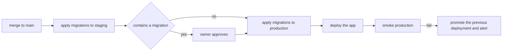

# 07 Operations

How the product is built, shipped, watched, recovered, and paid for. One person operates it, so everything here favors automation, written steps, and early warnings.

## 1. Environments

| Environment | App | Database and auth | Data | Purpose |
|---|---|---|---|---|
| Local | Dev server | Supabase local stack in containers | Seed data, throwaway | Development and most tests |
| Preview | One deployment per pull request | Staging project | Seeded test accounts and sample lessons | Review by the owner |
| Production | Live site | Production project | Real | Learners and the owner's lessons |

- Two Supabase projects, staging and production. The free plan allows two active projects (E-11). Production moves to the Pro plan before launch.
- Preview deployments sign in against staging. Their addresses must be covered by the auth provider's redirect allow-list; configure a pattern for the preview domain, not individual addresses.
- Lessons are data, so they are per environment. The owner writes real lessons in production only. Staging has seeded sample lessons.
- Configuration is validated at build and at start (`02-architecture.md` section 13). `.env.example` is the list of record.

### 1.1 Configuration as files

Where a vendor supports configuration in the repository, it is used: database schema and policies as migrations, auth and local stack settings in the Supabase config file, hosting settings in the project config file, pipeline definitions as workflow files. Settings that exist only in a vendor's screen are listed step by step in `docs/runbooks/infrastructure-setup.md`, and a script (`pnpm infra:verify`) checks what can be checked from outside: response headers, redirect behavior, the health endpoint, DNS.

## 2. Continuous integration

### 2.1 Pull request pipeline

| Job | Does | Runs when |
|---|---|---|
| `static` | Format, lint (import rules, no raw HTML, no inline strings), types, AI attribution check (handbook section 4.1), secret scan, dependency audit | Always |
| `unit` | Unit, harness, and component tests with coverage | Code changes |
| `db` | Starts the local Supabase stack, applies every migration to an empty database, runs policy and integration tests | `supabase/` or server code changes |
| `build` | Production build, bundle secret check, runtime size check | Code changes |
| `e2e` | Journeys and axe checks on Chromium against the built app and the local stack | Code changes |

The workflow also runs when a pull request's title or description is edited, so the attribution check always sees the final text.

Rules for the workflows are in `.claude/rules/ci.md`: actions pinned by commit, least-privilege permissions, a timeout on every job, frozen lockfile, no secrets in pull request jobs.

### 2.2 On `main`

- The full end-to-end suite on Chromium, Firefox, and WebKit.
- The deploy workflow of section 3.

## 3. Delivery

`main` is always deployable. A merge to `main` goes to production through one ordered workflow. The hosting provider's automatic production deploy is turned off so that the order below is guaranteed. Preview deployments stay automatic.

1. Apply migrations to staging.
2. If the change contains a migration, wait for the owner's approval in the production environment. Otherwise continue.
3. Apply migrations to production, then deploy the app. The database always moves first.
4. Smoke production: the health endpoint, the home page, one lesson page, one runtime file, the response headers.
5. On failure, promote the previous deployment and alert the owner.

### 3.1 Database changes

- Forward-only migrations. An applied migration is never edited.
- **Expand, then contract.** A change that the previous app version could not work with is split: first add, deploy code that uses both, then remove in a later change. Every migration's pull request states whether the previous app version still works with it.
- Migrations are tested from an empty database on every pull request.
- No command is ever run against the production project from a working machine. Production changes happen in the deploy workflow. The one exception is the owner adding his own admin row, by the runbook.

### 3.2 Rollback

- App: promote the previous deployment. Target: within 5 minutes (NFR-REL-04). The owner practices it once in WP-7.3.
- Database: not rolled back. Because of expand and contract, the previous app version works against the new schema. A bad migration is fixed forward.
- Lessons: a lesson that turns out wrong is unpublished or archived in the dashboard, at once, with no deploy.

## 4. Observability

### 4.1 Logs

Structured JSON on the server: request ID, action or route, outcome code, duration. No email, name, or learner code (NFR-PRIV-03). The request ID is shown on error pages so a learner can quote it (NFR-OBS-01).

### 4.2 Errors

Server errors are logged with the request ID and the release version. Client errors are sent to `/api/client-error` with the release version, the route, and a short error code: runtime failed to load, worker crashed, an unexpected exception. No message text from learner code is sent.

### 4.3 Analytics

The hosting provider's analytics, which uses no cookies: page views and Core Web Vitals. No custom events in this release.

### 4.4 Uptime

An external uptime service checks `/api/health` every few minutes and emails the owner when it fails (NFR-OBS-04). The owner creates it in WP-7.3.

## 5. Service levels

This release sets no formal objectives. It has three numbers the owner looks at each morning for the first two weeks: uptime from the uptime service, client error reports by code, and sign-in failures in the auth provider's log. Objectives are set from that data.

## 6. Backup and recovery

- The provider's daily backups on the Pro plan, kept 7 days (E-11). This is the reason production must be on Pro before real learners arrive: free projects have no backups the owner can download.
- When FR-ADM-12 is built, a course export is a second copy of the lessons that the owner keeps himself.
- Schema, policies, and configuration are in Git.
- Recovery point 24 hours. Recovery time 4 hours.
- **Restore drill**: in WP-7.3 the owner restores the latest backup into the local stack by the runbook and runs the verification script (table counts, one known lesson, policy checks). A backup that has never been restored is not a backup.

## 7. Rate limits

Starting values. Every write is also bounded by a database key or a size check, which is the last line.

| What | Limit | Where |
|---|---|---|
| Email code requests | The provider's limits (one resend per 60 seconds per address, a project-wide hourly cap sized for launch day) and a bot challenge | Auth provider |
| Any `POST` to the app: server actions and report endpoints | 120 per minute per network address | The host's firewall |
| Report endpoints | Body at most 8 kB | Handler |

The host's rate limiting is billed by usage on the Pro plan (E-22). WP-7.1 creates the rule and checks its cost on the usage page. If it is not available or not affordable, the fallback is a small counter table in Postgres, used by the action wrapper.

Provider settings to configure in WP-2.2: a custom email sender (the built-in one is limited to 2 emails per hour, E-11), sign-in rate limits, the bot challenge, code lifetime, and the email template that shows a code.

## 8. Incidents

| Severity | Meaning | Response |
|---|---|---|
| S1 | Learners cannot open or run lessons, or data is at risk | Act immediately. Roll back first, investigate second. |
| S2 | Sign-in, sync, or the dashboard is degraded | Same day. |
| S3 | Minor defect or a single lesson | Next working session. A wrong lesson is unpublished at once. |

Every S1 and S2 gets a short, blameless write-up in `docs/reports/incidents/`: timeline, cause, what limited the damage, what will change.

### 8.1 Runbooks

Each is a numbered procedure in `docs/runbooks/`, written in the work package that introduces the thing it covers.

| Runbook | Written in |
|---|---|
| Infrastructure setup from zero | WP-1.3 |
| Deploy and roll back | WP-1.3 |
| Make the owner an admin | WP-2.3 |
| The owner lost the authenticator | WP-2.3 |
| Sign-in or email provider outage | WP-2.2 |
| A published lesson is wrong | WP-4.3 |
| Restore from backup | WP-7.3 |
| Rotate a secret | WP-7.3 |
| Spend or usage spike | WP-7.3 |
| A learner asks by email to delete their data | WP-7.3 |

## 9. Cost and vendor limits

Facts checked on 2026-11-13 and 2026-11-15 (see `09-evidence.md`). Prices and limits change; the owner confirms them before paying.

| Vendor | Plan needed | Why | Watch |
|---|---|---|---|
| GitHub | A paid personal plan | Branch protection on a private repository is not available on the free plan (E-14). | CI minutes included in the plan |
| Vercel | Pro, 20 US dollars per month per developer seat | The free plan is limited to non-commercial use (E-13). | Function usage, data transfer, firewall rate limiting |
| Supabase | Free for staging; Pro at 25 US dollars per month for production before launch | Free projects pause after a week of low activity and have no downloadable backups (E-11). | Monthly active users, database size, egress |
| Email provider | A plan whose daily cap exceeds the expected launch-day email sign-ins | Required for sign-in codes. | Daily and monthly send caps, deliverability |
| Bot challenge, uptime check | Free tiers | | |
| Domain | | Needed on Day 1 for email sending and Google sign-in. | Renewal |

### 9.1 The costs that scale with success

- **Runtime transfer.** The Python runtime is about 5.5 MB per new learner with Brotli (E-02). It is cached permanently after the first visit. Ten thousand new learners in a month is about 55 GB of transfer.
- **Page rendering.** Every page view runs a function, because pages are rendered per request (ADR-0028). Lesson content comes from the data cache, so a view costs rendering time and usually no database query.

Both show on the host's usage page. That page is the number to watch after a video does well.

### 9.2 Scale triggers

| When | Do |
|---|---|
| Runtime transfer passes half of the plan's comfortable allowance | Point `RUNTIME_ASSET_BASE_URL` at an object store with no egress fees behind a CDN. No code change. |
| Function usage passes half of the plan's included amount, or page response time gets slow | Move public pages to static rendering with a hash-based script policy. ADR-0028 describes the route. |
| Monthly active users pass 40,000, or the database passes 400 MB | Move to the next database plan. |
| Email sends pass 80 percent of the daily cap | Raise the plan before the next campaign. |

## 10. Launch readiness for a traffic spike

Heap's traffic arrives in bursts when a video spreads. Before launch:

- A lesson page view with a warm cache makes no database query. A test proves it.
- The request proxy does no network work without a session cookie, and fails open if the auth service is slow.
- Runtime files are served with immutable caching from the host's CDN.
- The firewall rate limit is on.
- Spend alerts are set at every paid vendor (NFR-COST-02).
- The owner has rolled back once and restored once, each from the runbook.
